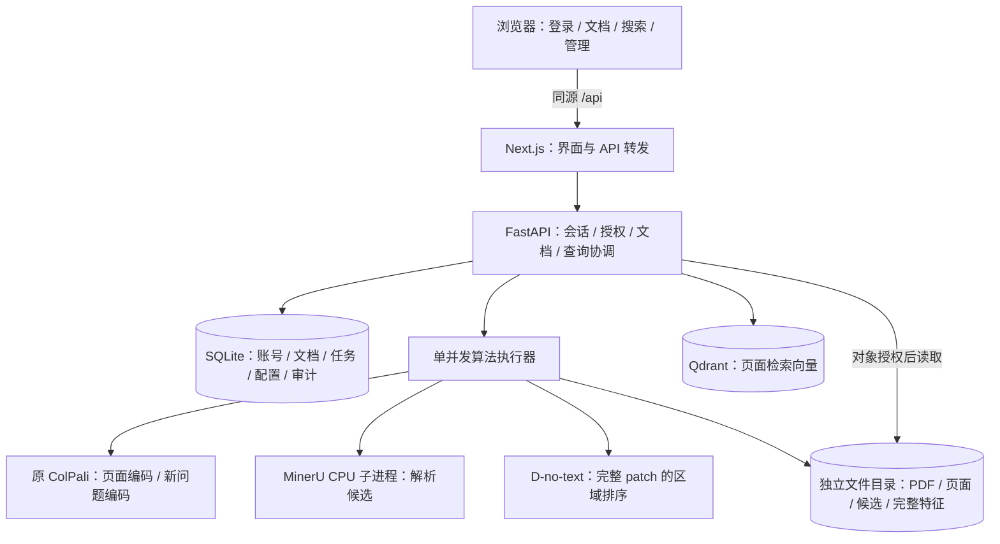
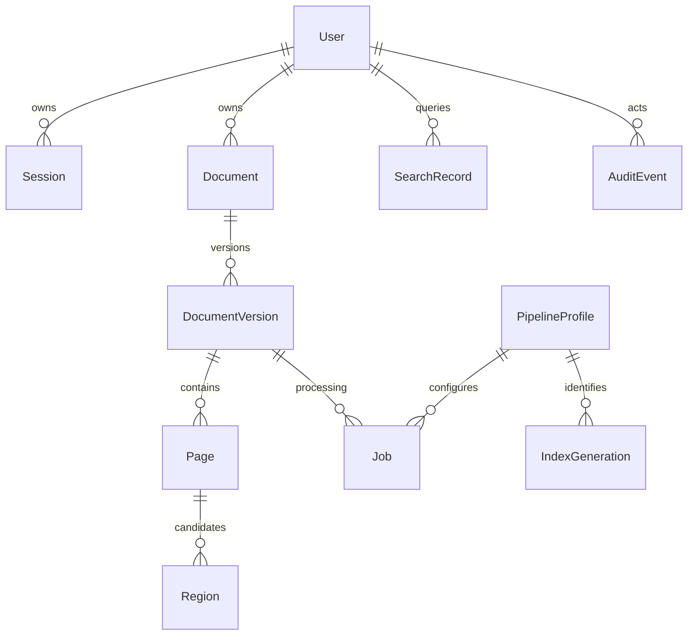

# 架构、数据实体与部署设计

日期：2026-11-05。本文的Web架构是 **[设计]**。阶段1A已实现独立Python环境中的ColPali本地adapter、完整页面/问题编码与CPU MaxSim CLI，见 [本轮验收](stage1a-verification.md)。尚未启动Web、SQLite、Qdrant或认证流程；下图不是现有运行拓扑。阶段0源码事实保留在 [核查记录](source-audit.md)。

## 1. 复用决策

采用 **Snappy 的选择性工程复用**：保留 Next.js/React、FastAPI、生成 OpenAPI SDK、上传/搜索布局、lightbox 和 Qdrant 客户端模式。补齐账号与元数据库；替换原模型加载和区域评分连接；第一版关闭聊天、DeepSeek-OCR、原 interpretability 和全库清空路由。

不整体复制旧仓库。迁移时按依赖闭包复制所需源码、配置模板、锁文件与许可证，在来源清单记录路径、源提交、源文件哈希、本地差异。Snappy 当前 Dockerfile 的 HTTPS 源修改需要保留来源记录，但本方案不直接沿用其 Python 3.10 镜像。

区域算法优先从精简 `layoutpatch-evidence` 的已比对模块迁入独立算法包，保留原接口和依赖闭包；7 个核心文件与原研究库字节一致。不能把精简仓库整套实验 CLI 作为在线请求入口，也不能用复制成功替代行为一致性检查。权重和模型只读连接，输出均进入新项目数据目录。

## 2. 最小运行结构

这是逻辑结构，不拆成多个新微服务。一个 FastAPI 进程、一个受控模型执行器；同步计算放入受限工作线程/子进程，避免堵塞异步请求。ColPali 只加载一份，页面编码与问题编码共享执行互斥；首版限制并发，记录等待时间。MinerU 使用隔离的 Python 子进程和现有 CPU 模型。

页面检索先用完整 `[1031,128]` 多向量、MaxSim、无量化、无压缩、无均值池化预取。Qdrant 使用 `original` 命名向量和 `MAX_SIM`；首轮一致性检查使用 exact 搜索配置。先证明与 ColPali 参考分数/排名一致，再考虑更复杂检索配置。

## 3. 登录和会话

建议密码采用 `pwdlib[argon2]`；服务端会话使用 `starsessions` 中间件并薄适配 SQLite `SessionStore`。这两个库在新环境尚未安装/验证，需阶段 1B 锁定兼容版本及会话存储接口；不得宣称 Snappy 已提供认证。会话采用随机不可预测 ID，数据库仅存 ID 的哈希及会话状态，Cookie 仅携带原始 ID；不自创密码或签名算法。

Cookie：HttpOnly、SameSite=Lax、Path=/，不设跨域 Domain；HTTPS 开启 Secure，本机 HTTP 开发显式关闭。建议空闲过期 30 分钟、绝对过期 8 小时。登录/提权时轮换会话；退出、改密、重置密码、停用均撤销对应会话。每次请求核验账号启用状态和 `auth_version`，不能仅在登录时检查。

写请求校验固定可信 Origin；已登录写请求使用会话绑定的 CSRF token。登录限同源 JSON 请求，拒绝任意外域 CORS 和表单跨站提交；密码错误采用统一提示和轻量失败限速。浏览器请求统一走生成 SDK，CSRF header 在 SDK 中央配置注入；Cookie 不存 localStorage。管理员初始化使用交互输入，不硬编码通用账号。

## 4. 权限过滤与一致性

SQLite 是可见性的权威来源。每次查询由服务器生成 `AllowedScope`：当前用户拥有的就绪文档版本，加当前共享的就绪版本；管理员请求管理范围时额外审核并审计。前端不能传任意 owner 或自行给出可访问文档集合。

Qdrant payload 至少含 `document_id/document_version_id/page_id/profile_id/owner_id/visibility`。**实际检索必须带数据库生成的 `document_version_id` 白名单和索引配置过滤，在 Top-k 前生效。** `owner_id/visibility` payload 仅辅助诊断，不作为唯一授权依据，避免撤回共享与索引同步之间的窗口。

- 白名单为空直接返回空结果，绝不转为无过滤搜索。
- 构造过滤失败、SQL/Qdrant 异常时返回明确失败，绝不降级为全库。
- 后续若启用 prefetch，每层 prefetch 及最终评分都必须带相同过滤；本月基线先禁用它。
- 返回前再检查 `access_epoch` 和账号状态；如果撤权/删除与查询重叠，丢弃旧响应并重试一次或返回可重试冲突。最终检查是竞态防护，不代替检索前过滤。
- 文件、缩略图、区域、裁剪与历史每次从数据库回溯文档授权。返回历史时按当前权限过滤旧命中，不能由历史快照恢复已撤权内容。

阶段 1 优先不做查询结果缓存；需要缓存时 key 包含用户 ID、范围、`access_epoch`、索引版本、profile、问题、Top-k。发布/撤下共享、文档删除、账号变更均递增 epoch 并失效缓存。页面特征可内部复用，但不能通过公开 URL 访问；首版不做跨用户去重或“文件已存在”提示。

所有受保护响应采用 `Cache-Control: private, no-store`，Next.js 不静态缓存用户数据；换账号/退出清空客户端 store。原 `/files/{bucket}/{path}` 不裸挂载，新系统只按数据库资源 ID 解析存储路径，并继续保留目录越界校验。

## 5. 数据实体

| 实体 | 关键字段和约束 |
|---|---|
| User | UUID、唯一 username、password_hash、role=user/admin、active、must_change_password、auth_version、创建/更新时间 |
| Session | token_hash、user_id、auth_version、CSRF 状态、创建/上次访问/绝对过期、revoked_at |
| Document | UUID、owner_id、display_name、visibility、source_sha256、active_version_id、状态、删除标记；文件名不是主键 |
| DocumentVersion | UUID、document_id、version、PDF 哈希、源文件引用、page_count、render_profile；不可变输入身份 |
| Page | 稳定 UUID、document_version_id、page_index 从0、width/height、render_sha256、预览文件引用；同一版本页序唯一 |
| Region | page_id、parser_profile_id、region_id/layout_id、像素 bbox、type、text/source、candidate_hash；候选版本内唯一 |
| Job | UUID、owner_id、document_version_id、kind、stage、status、progress、attempt、error_code、profile_id、时间、心跳 |
| PipelineProfile | 不可变配置 JSON、规范化哈希、编码器/处理器/解析器/评分/预算身份、validated 状态 |
| IndexGeneration | profile_id、集合名、状态、版本、页面数、向量数、校验记录、激活时间 |
| SearchRecord | user_id、query、范围、profile/index、命中对象引用、区域状态、分阶段耗时、状态、时间 |
| AuditEvent | actor、action、object、reason、结果、时间、request_id；不存密码/令牌 |
| SystemState | access_epoch、active_profile_id、active_index_generation；原子更新 |

SQLite + SQLAlchemy + Alembic，启用外键、WAL、短事务及适当 busy timeout。GPU/OCR 操作不在长数据库事务中执行。首版单 worker；不要通过增加 Uvicorn workers 复制模型和内存队列。

## 6. 任务、删除和重建

入库状态：`queued → rendering → encoding → indexing → completed`；候选解析与区域准备单独记录，可为 `pending/ready/failed/no_candidates`。页面索引就绪但解析失败允许检索页面。所有阶段写数据库，任务输出先写新版本的临时区，完成核对后激活。单并发调度器从数据库领取任务，客户端断线不取消任务。

重启时仍在执行的任务标记 `interrupted`；首版提供显式重试，保留输入/配置/attempt，不承诺自动续跑。停用用户时取消其待执行任务，执行中任务在检查点停止；账号停用本身不删除文档。

删除先授权，再事务标记 `deleting`、增加 epoch，立即从查询白名单排除；后台按 document/version ID 删除 Qdrant points、候选、完整特征、预览和源 PDF，完成后记 `deleted`。失败保留 `delete_failed` 及可重试记录，不能重新出现于搜索。下载/历史也检查删除标记。管理员不得通过原按 filename 删除接口绕过该流程。

配置不可原地改写；仅激活经过验收的 profile。重建写到新集合/新 IndexGeneration，核对页面数、模型身份及授权测试后原子切换，旧代可回退；不清空唯一可用索引。不把原任意配置编辑器直接暴露给管理员。

## 7. 模型与特征的分层身份

页面检索向量身份包含：ColPali adapter/base revision 与本地校验、processor 参数、query token 规则、维度、页面渲染版本、压缩策略/预算及评分规则。编码器或渲染变更要求重编码；压缩预算变化要求重建检索向量；仅 D checkpoint/候选变化只重建区域派生特征，不无故重编码页面。

D 使用的完整 `[1024,128]` patch 与压缩检索向量分开。默认保留完整页面特征；BF16 `[1031,128]` 原始张量约 258 KiB/页，float32 约 516 KiB/页（计算估计，未含文件/索引开销）。D 的 P′ 若缓存，增加 checkpoint、候选哈希和算法代码版本身份。不得把缩短序列直接送给 D，也不得只报压缩索引大小而隐去完整缓存成本。

## 8. 本机部署方案与降级边界

推荐首版：Windows 原生 Next.js + 独立 Python 3.11 后端/模型环境；Docker 只运行独立 Qdrant；MinerU CPU 使用独立解析环境。理由：本机已有原研究 CUDA 依赖和模型，避免上游两套 GPU 服务、Python 3.10 镜像与默认底座同时介入。

- 前端 `127.0.0.1:3000`，同源 `/api/:path*` 转发到 `127.0.0.1:8000/:path*`；代理须保留 Cookie/Set-Cookie、CSRF header、二进制/Range 语义。阶段 1B 做实测。
- 后端 `127.0.0.1:8000`，一个进程；未来命令模式为 `python -m uvicorn main:app --app-dir backend --host 127.0.0.1 --port 8000`，现在尚无这些文件，不能运行。
- Qdrant 新容器、独立 volume/collection 前缀，6333 只绑 loopback，配置服务端 API key；浏览器不持有 key。不要复用旧 Snappy 空库卷来承载本项目文档。
- 不对浏览器提供模型端口；本机操作系统账户的直接磁盘访问不属于此 Web 用户隔离边界。
- 后端、前端、解析器依赖分别锁定。沿用 Snappy yarn.lock；宿主未找到 yarn，阶段 1 需核实 Corepack/锁文件对应版本。不要把旧 .venv 变成本项目可写环境。
- 模型启动强制 offline/local_files_only，显式指定 adapter/base 本地路径；缺失就报错，不触发远程下载。GPU 当前空闲不足以证明加载可行，先 batch=1 测峰值。
- 数据根目录默认独立项目 `runtime/`（Git 忽略），展示交付时可改为仓库外路径；迁移和备份同时覆盖 SQLite、原文件、配置身份，索引可按记录重建。

Docker 引擎未启动，因此容器镜像/卷当前内容未核验。先解决 ColPali 离线加载；若完整栈阻塞，则继续缩小到该技术栈的必要模块，不另接大型框架。不能通过换底座、量化或训练掩盖兼容性问题。
