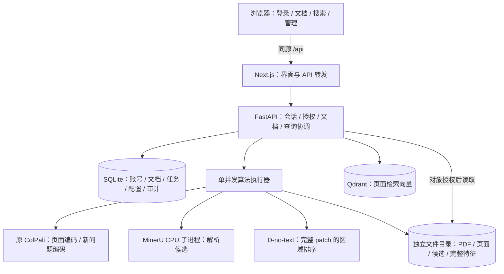
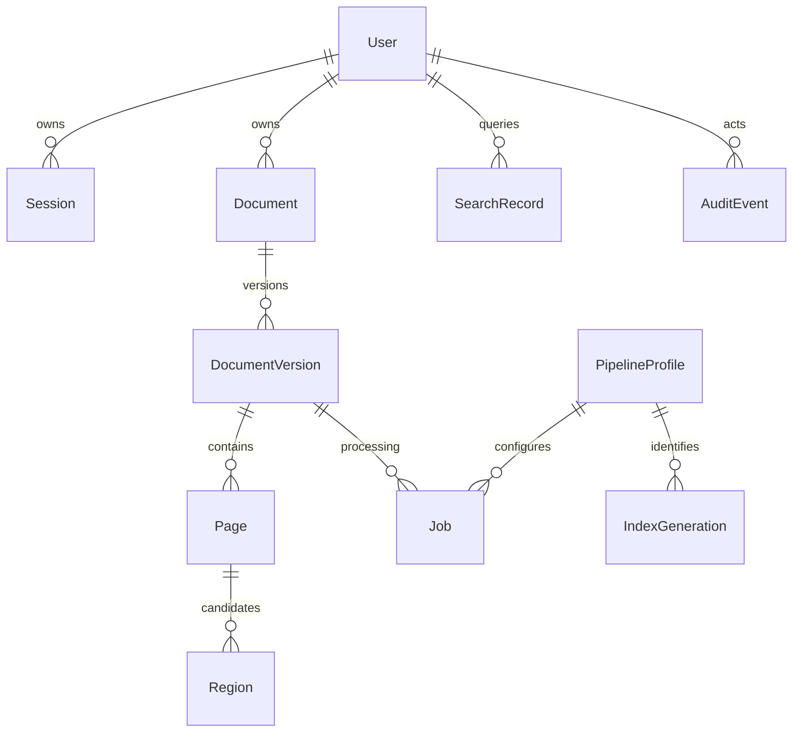

# 架构、数据实体与部署设计

## 2026-11-08｜R32 / 3-6主题独立状态

新增lib/theme.ts（纯偏好store与预绘制脚本）、ThemeToggle和theme.css。RootLayout加载统一语义变量，默认根dark；Home和Workspace只挂按钮，不把theme放入Home认证/请求状态。useSyncExternalStore独立订阅与storage同步，SSR固定dark，首绘前恢复偏好，存储故障不阻断当前页。只存light/dark，不缓存身份、问题、结果、签名或Blob。

六份现有CSS使用角色变量，文档paper与区域几何保持；另修窄屏时打开history dialog的祖先display和深色canvas缩放文字。后端/迁移/原模型/SDK/业务hooks及region组件不变。新227后端含1既有跳过、13CPU/115前端/tsc/隔离build/73网页通过；真实两模式和区域共3新CPU Q、1旧P′/D0，不在切换时推理。详见[手册](stage3-6-runbook.md)。

正式0008/旧GET/旧前端保持未部署，隔离服务结束后按身份停止。阶段3各小批的适用证据不能相加当作整体出口；下一步只建议联动复核并等待明确指令，不自动进行预算适配、部署或阶段4。

## 2026-11-08｜R31 / 3-5配置与索引增量

保留不可变colpali_full_v1；profile_identity集中校验冻结配置，离线子进程核13本地文件/2实现，不加载模型、不允许网络。0013新增操作/事件和system_state.index_epoch>=1，旧空活动指针在预约锁内固定原唯一ready代。仅管理员状态/verify/rebuild/activate及网页，无任意配置编辑或预算profile。

管理流程复用producing(engine)产物租约：短BEGIN IMMEDIATE预约和最终提交，锁内重查会话/CSRF/首改/角色、全部ready版本/页身份、活动代与epoch；锁外逐点读取/核完整向量，重建至UUID专属候选，最终核候选再ready。切换/回退重核本地及远端，状态/最小事件原子；失败保留旧代/部分候选。全库单running、actor请求幂等，启动遗留中断不重试。远端与SQLite没有分布式原子性，进程崩溃可留专属孤儿集合，保留供人工核对、不自动删除。

原入库捕获/复查并递增epoch，AllowedScope fingerprint含epoch，A→B→A仍拒绝迟到检索/区域。旧查询历史绑定索引ID，打开不推理且重核当前权限；已有历史标量规则保持。物理清理等产物租约退出后独占，单数据库单worker限制不变。成本仅逻辑向量字节和实测管理时间。

新227后端/13CPU/109前端、62索引/89原链/23HTTP/28浏览器与build通过，27新CPU Q含首失败5，2新D/4旧P′命中；详见[手册](stage3-5-runbook.md)。正式0008保持未部署，未来新备份/迁0013/单worker前后端重启新验收；本轮停于3-6前。

## 2026-11-08｜R30 / 3-4C管理查询增量

新增audit.schemas/service/routes，无新表/迁移。SQL UNION ALL明确列投影汇集四事件和四任务，不ORM载入私有内容；两次新事务验证身份及脱敏快照，稳定排序/分页及scope指纹防止中途撤销或列表变更仍返旧成功。原公共写业务/事件事务与执行器不改，管理员内容权限不扩大。

Home接useAudit，Workspace挂管理员入口/AuditPanel与局部audit.css；独立取消代号/15秒等待，身份/离页/首改/新查询清旧管理状态。默认7UTC日/单次31日、筛选/10条分页、空与故障反馈，未知不自动重试。OpenAPI/SDK同步，实际67份一致。最小事件/标记随库保留，无自动过期；任务仅当前状态，历史本人删除/旧ID410保持。

查询两次扫描窗口内全部最小投影，未做大库容量承诺。新208后端/13CPU/101前端、89ASGI/44HTTP/32浏览器及隔离build通过；14新原CPU query/3旧P′命中/D0，详见[手册](stage3-4c-runbook.md)。正式0008/旧GET构建未部署，单worker/未来备份迁0012重启另验，停在3-5之前。

## 2026-11-08｜R29 / 3-4B历史网页增量

Home接useRecordedSearch、useHistory及history-state；Workspace挂本人HistorySidebar/Menu/Dialog/Banner和独立history.css，复用现有SDK、认证锁定、页面预览与useRegions。新增22前端测试后共93；后端、表、迁移、OpenAPI/产品SDK、算法和依赖均保持。

提交、列表、详情和写入各自RequestGeneration；提交/写入同步ref防同帧重复，迟到响应须代号和身份有效才应用。未知POST保留原body与request_id，240秒等待/本地取消均不承诺模型取消；显式同ID核对才重发。其他请求15秒；元数据原version、无乐观更新/写入重试。对外反馈明确未知与本地清理，不误称已删除。

历史结果复用SearchResponse呈现，保留原rank-score和失效缺口，当前会话新签PNG及显式区域定位。恢复单文档只保存已核对标量目标，不伪造授权列表对象；失效禁止自动切库。清结果统一取消详情/提交、回收Blob、清区域，退出/换号/401另清列表/草稿，原生命周期守卫保持。实际新原链/浏览器与限制见[手册](stage3-4b-runbook.md)。正式仍0008及旧运行构建，新源码已POST，未部署；不自动进入3-4C、主题或预算。

## 2026-11-08｜R28 / 3-4A查询历史增量

新增history.schemas/service/routes及0012的QueryRequest/QueryHistory/QueryHistoryHit/HistoryEvent四表。POST /search和旧GET共用execute_search，沿用原算法/过滤/命中校验/排序和scope复核；预约/最终保存为短BEGIN IMMEDIATE，锁后当前身份/CSRF/版本/范围复核，模型在锁外。成功或合法空范围才原子落正文/命中/事件/completed；持久request marker实现并发一次推理及删除后去重，失败/启动中断不会自动推理。

历史命中只存标量ID/hash/授权代次和原rank/score，特意不对document/version/page建FK、不保存名称/路径/签名/Blob/区域，避免历史阻挡3-3物理清理或复活撤回。详情从当前allowed_scope筛选身份一致的旧引用，再用当前会话新签PNG，失效只计数，打开/重放不执行query或D。本人元数据版本/删除和最小事件原子，title/置顶不改变原问题；私有历史无admin跨owner旁路。

历史quota1000含运行预约，显式删除释放，不自动过期；问题/标题/命中删除后仅留无正文的请求摘要/状态及最小事件，保留政策后续3-4C制定。前端只新增生成SDK/线路契约测试，没有工作台/侧栏/主题变更，现有GET不落历史。正式仍0008未部署；[本轮证据与限制](stage3-4a-runbook.md)不扩大成完整阶段3完成。

## 2026-11-08｜R27 / 3-3删除生命周期增量

新增documents.deletion公共BEGIN IMMEDIATE事务、CleanupRunner及0011的DocumentCleanup/DeletionEvent。墓碑和授权版本先原子提交使全部现有读取/管理入口失效；后台物理清理与外部Qdrant/文件不构成一个分布式事务，使用持久manifest、精确点删除/保留点校验、幂等缺失路径及失败重试协调。清理完成只留通用名墓碑/控制和最小事件，删除原版本/页/候选/特征/解析/任务，不引入恢复入口。

documents.lifecycle以数据库规范路径登记进程内产物租约。upload、ingest、parse、regions生产者在完整产物写入期持有租约，清理等待现有生产者退出再独占，各生产者仍锁内重查墓碑；墓碑本身不等长模型任务。支持每数据库一个后端worker，不能把进程内锁说成多进程互斥。路径/根/reparse/跨文档引用/未知缓存归属和集合前缀保守拒绝，隔离验收只使用复制的专属根/集合。

Home新增useDeletion和本人删除视图，复用现有样式/会话锁定/Blob回收。独立请求代号/同步重复锁、明确确认及未知结果不重发；真实浏览器发现顶层重复面板，修为单工作区main并补SSR断言。SDK新增DeletionService及四模型；原ColPali/D权重/算法/profile及依赖保持。详见[手册与边界](stage3-3-runbook.md)。正式仍0008未部署；后续历史打开必须延续当前授权，不得复活墓碑。

## 2026-11-08｜R26 / 3-2共享增量

新增documents.sharing路由/公共事务、0010的授权版本列和最小SharingEvent。管理集合明确为当前管理员本人非删除文档；普通own＋active-admin-shared读取规则保留，其他private无管理/搜索旁路。复用accounts BEGIN IMMEDIATE，在锁内重查会话/首改/admin/CSRF及目标版本，visibility/access_version/事件原子提交；拒绝事件与成功/noop区分，插入事件失败回滚全部状态。

授权版本作为访问代次进入scope/列表指纹/PageFile和v2预览/裁剪签名，推理/读取后的新事务能发现shared→private→shared ABA。regions.service只比较目标文档授权scope，不将授权状态送入D或P′算法缓存，合法旧P′仍可复用；完整BF16、原ColPali/D代码、权重/profile和候选不变。

Home接useSharing、共享管理视图与现有身份锁定/Blob回收；SharingPanel/Dialog只展示对象/影响/确认，hook负责独立请求代号、同步重复锁、有限等待与未知写不重试。SDK新增SharingService四模型。实际后端/SDK/网页及隔离真实原链证据见[手册](stage3-2-runbook.md)，正式0008/原服务保持，未部署。下方旧“未实现共享”只描述其历史时点；删除/历史/主题/预算仍未实施。

## 2026-11-08｜R25 / 3-1B前端增量

新增AccountsPanel/AccountActionDialog、account-state和useAccounts；原工作台增加管理员专属accounts视图，复用既有AdminService与内存CSRF。列表和写入各用RequestGeneration，ref即时防重复；表单密码在本次DOM/请求中，提交即清空，不进入React状态或应用存储。固定安全提示，不回显后端任意错误文本。

离页、新检索、退出、换号、首改和身份锁清管理状态；401锁工作台、403重新查身份，既有会话轮询新增role比较。本人实际reset/revoke后清全工作台/Blob，不明结果先重新确认身份，无自动重试写。后端最后管理员/事务和文档授权仍沿用R24，前端按钮不是安全边界。隔离3001/8001＋生产前端副本验证，正式0008与原服务未部署本批；[证据范围](stage3-1b-runbook.md)不扩称全部阶段3完成。

## 2026-11-08｜R24 / 3-1A增量

用户管理后端/SDK完成，最小AccountEvent通过0009独立表接入。公共accounts业务层在BEGIN IMMEDIATE锁内重新校验HTTP管理员会话/CSRF，读取目标与启用管理员计数，原子提交账号/旧会话撤销/事件；CLI共享最后管理员保护。成功/noop/已授权业务拒绝记录最小元数据，无凭据和私人查询正文；未提供事件查询或保留策略，留3-4C。

新增管理路由不改变documents/search/regions普通授权边界；数据库异常响应跳过再次心跳写入以确保锁超时503可送达。正式保持0008及原服务，本轮只迁移隔离克隆到0009；正式启用需另行备份/迁移/重启。实际权限、并发、原模型CPU新Q与区域回归见[手册](stage3-1a-runbook.md)。下方架构中未落地实体/流程仍按设计理解，不由本批扩大为已实现。

## 2026-11-08｜R22 / 2-6当前实现

在R21内部regions.service外新增status/rank/crop三条会话路由；复用既有Document/Version/Page/PageFeature、解析三表及活动索引，无新表/迁移，正式保持0008。推理或PNG读取不占用旧读事务，完成后新事务复核会话、当前归属/活动版本/索引、渲染、解析task/profile/候选整集和D身份。签名crop绑定当前会话及全部输入，不提供静态产物目录或跨private旁路。

Home传入submittedQuestion，useRegions分开管理区域与crop请求代号/取消及Blob；RegionControls负责状态、显式解析/定位和Top5列表，RegionCanvas将原PNG与SVG放入同一frame，以原尺寸viewBox共同缩放。身份失效、换页/范围/问题、隐藏及退出清理旧区域；局部失败保留原图，模型重试与解析重试分开。SearchHit.region_status仍not_requested表示search自身未执行定位，实际状态来自独立regions/status。见[手册](stage2-6-runbook.md)、[真实验收](checks/stage2-6-verification.json)。原ColPali完整特征及D代码/config/权重未改，预算序列不能送D；下文旧状态不授权重复开发。

## 2026-11-08｜R21 / 2-5当前实现

新增受控d_core与DNoTextAdapter、regions.service内部授权组装、原ModelWorker的regions分支。无新表，正式保持0008；P′使用私有runtime不可变文件cache，包含完整特征/候选/模型/代码/活动索引身份。query每次在同一worker真实编码，CPU D复用该Q；完整1031行与派生1024行P′分开，预算序列不能送D。推理后重新授权，公开会话边界/区域HTTP/高亮仍待2-6。见[手册](stage2-5-runbook.md)、[实际检查](checks/stage2-5-verification.json)。下文“D未实现”按历史轮次理解。

## 2026-11-08｜R20 / 2-4当前状态

实际新增ParserProfile/ParsingTask/PageParse三表，候选JSON整集与来源hash存PageParse；独立CPU子进程由单个解析调度线程显式排队。未实现目标Region派生表、D或网页高亮；解析不参与索引激活。

见[本批手册](stage2-4-runbook.md)、[汇总](checks/stage2-4-verification.json)及[保护](checks/stage2-4-protection.json)。正式0008仍原2文档13页，新解析表空，页面底座和完整特征保持；不下载/训练/提交推送。

## 2026-11-08｜R19 / 2-3C真实实现

0007在jobs追加cancel_requested_at，新增(job_id,attempt)主键的job_attempts保存每次阶段/进度/错误与时间。重试在BEGIN IMMEDIATE下复核本人、当前attempt、源PDF大小/SHA、文档registered且未激活；旧尝试保留、新尝试独立产物目录，仍单持久调度线程、原ColPali ModelWorker及完整特征。

running取消仅记请求；渲染后、页间、索引写入间和最终激活事务复核，已提交completed不可撤销。默认900秒总时限按检查点执行，既有操作各自有限超时；重启receiving/running转interrupted，已保存取消则cancelled，building索引转failed保留。非空旧任务只回填当前已知attempt，不生成未知过去记录。

useUploadTasks持有文件/随机上传ID、三个独立请求代号、本人分页及轮询；无私有localStorage。Home统一身份/隐藏/退出门禁并防退出等待期间poll回填，任务变化清结果/PNG并刷新范围；UploadTasksPanel只展示/回调。停止发送等待不等于取消任务，completed不自动选中文档。测试gate仅隔离adapter导入，正式仍backend.main:app。见[手册](stage2-3c-runbook.md)。

**2026-11-08｜R18 / 2-3B-2实际补充：**Home集中两种范围与目标、列表/检索两套RequestGeneration、游标与私有状态；ScopeSwitch/DocumentPicker只负责展示/回调。列表仅document模式加载，筛选不暗换目标；同筛选快照变化保守清选择，切换范围清结果/PNG，锁定清列表。服务端继续决定可读/ready/Top-k前白名单，前端不替代授权。无表/公开API/算法/SDK变更，见[手册](stage2-3b2-runbook.md)。

## R17 / 2-3B-1实际实现（2026-11-07）

前端Home保留认证/CSRF、请求代号/取消、图片Abort/Blob及广播/可见性控制，工作台JSX抽到frontend/components/workspace/workspace.tsx的Shell、Sidebar、QueryComposer、RetrievalResults、EvidencePanel。子组件只管理折叠、视图及焦点，完整response/hit仍传回Home，输入与已提交问题仅存内存。workspace.css按.ws-*作用域实现桌面三栏及窄屏独立阅读视图，不覆盖登录/首改/断连。

本批没有改表、后端、SDK、代理或模型。仍调用searchPages(q,k)文档库接口，无列表/单文档UI；正式数据及完整特征指纹保留。验收助手只在R17隔离服务运行，正式仍backend.main:app，见[实际手册](stage2-3b1-runbook.md)。B-2再接选择范围，C再接上传恢复；以下R16及更早段落为历史实施记录。

## R16 / 2-3A实际实现（2026-11-07）

0006在documents末尾追加display_name_key和索引，以NFKC＋casefold回填；原展示名和原列不变，无表重建。新建/ORM改名通过同一名称函数同步键，直接SQL维护须同时改键；名称筛选用参数化instr普通包含，不编码文件名、不触发模型。

GET /documents单独使用visible_document：本人非删除元数据包含未ready，其他只含启用管理员ready/shared；不改既有readable_document对search/PNG的ready要求。列表先授权/名称过滤，再按时间/ID倒序从服务器可见快照取单页，HMAC游标绑定会话、名称、limit和权限/元数据快照，返回前新事务复核。searchable仅表示DB当前版本与活动索引页面完整。完整服务器快照有线性成本，未承诺大库性能。

allowed_scope增加可选目标，先核对对象可见/ready，再限定document_id当前版本页，index_page_count仍是全代点数；两次scope使用相同目标，Qdrant页/版本过滤先于Top-k，任何失败不扩大范围。响应补充search_mode/document_id，SDK重新生成；现有PNG独立授权/会话清理不变。复用R15的21页和全特征只执行新query，未写向量/编码页面。实际范围/故障与后续边界见[本批手册](stage2-3a-runbook.md)。

## R15 / 阶段2-2实际实现（2026-11-07）

0005_ingestion仅增system_state单例活动索引指针、page_features全页特征来源表，不重建旧表。PageFeature按page_id保存encoder配置SHA、完整BF16 tensor/float32导出路径及哈希。已有ready索引仍保留；是否活动由指针决定，空指针只允许唯一validated/ready索引引导，多代无指针拒绝。正式迁移保留原10表数据，仍原13页。

单进程/单调度线程从SQLite领取queued任务；渲染走已有模型环境的CPU隔离子进程，144dpi/RGB/PNG并记录PDF几何和完整身份；页面与query共用单份ModelWorker及锁。保留完整1031×128 BF16特征供D，float32 JSON用于Qdrant，未用预算向量替代。后台任务不依赖浏览器保持连接；启动将running标INGEST_INTERRUPTED、building候选标failed，queued可继续、completed不重跑。

索引采用copy-on-write完整候选代：从活动Qdrant只读获取并核验旧点表示，复制时仅变更index_generation，加入新页，逐点复核候选；短BEGIN IMMEDIATE事务一次写Page/IndexPage/Feature、文档ready、任务completed和活动指针。旧集合及原页面不写入/重编码，候选中途失败不影响旧活动范围；切换重叠查询由返回前scope复核给409。文件与DB并非单事务，候选残留保持私有不可搜，清理/retry/cancel后置。完整代复制有存储与写放大，未声称大库适用。

已实测隔离13→17→21页和8新页真实编码；API schema及前端未变。当前实现/失败与限制以[2-2手册](stage2-2-runbook.md)及[汇总](checks/stage2-2-verification.json)为准。以下R14/R12段落为历史实施状态，后文其他实体仍可能是目标设计；MinerU/D/高亮、文档列表与单文档范围尚未实现。

## R14 / 阶段2-1增量实现（2026-11-07）

0004_upload_jobs新增持久jobs表和owner索引，沿用既有Document/DocumentVersion，不改Page/Search/Index/Qdrant。新PDF验证和存储后建立版本1；render_profile为pending标记，未选择或运行renderer。文档registered且active_version_id为空，现有ready过滤将其排除，所以新增未完成文件不会破坏13页ready索引。

上传为单后端worker下的短事务：授权与Origin/CSRF先验，写receiving预约；PDF字节写受控runtime目录的UUID路径，临时文件fsync后原子替换；再新事务复核会话身份，状态改queued。异常删除文件并尝试记failed；预约后进程意外退出，重启将receiving标interrupted。数据库、文件系统不构成单一事务，若失败记录也遇DB故障，接收中记录由启动恢复。页面编码/索引激活留2-2，显式重试/取消和更完整scheduler留后续批。

更新：2026-11-07，北京时间，R12。**1B-6整体启停与非空持久化通过适用范围，现有13页链路收尾。** 本轮45后端/3前端回归、78生命周期、13浏览器观察、10正式恢复、5组官方评分通过；[本机部署手册](stage1b-6-runbook.md)、[汇总](checks/stage1b-6-verification.json)。浏览器改密提交仍由用户本人操作，阶段2未开始。

正式0003、13页ready、profile validated不变；会话绑定图片授权在R11实现，本轮无应用/API变化或数据库迁移。下方包含完整目标设计，上传、PDF与区域仍未实现。学习记录见[05](过程记录/05_1b技术操作详解.md#r12)/[06](过程记录/06_1b逐步口述稿.md#r12)，03/04保持历史。后续分批实施顺序见[R13路线图](项目开发阶段规划与任务.md)；该规划未改变本节R12验收范围。

## 1. 复用决策

采用 **Snappy 的选择性工程复用**：保留 Next.js/React、FastAPI、生成 OpenAPI SDK、上传/搜索布局、lightbox 和 Qdrant 客户端模式。补齐账号与元数据库；替换原模型加载和区域评分连接；第一版关闭聊天、DeepSeek-OCR、原 interpretability 和全库清空路由。

不整体复制旧仓库。迁移时按依赖闭包复制所需源码、配置模板、锁文件与许可证，在来源清单记录路径、源提交、源文件哈希、本地差异。Snappy 当前 Dockerfile 的 HTTPS 源修改需要保留来源记录，但本方案不直接沿用其 Python 3.10 镜像。

区域算法优先从精简 `layoutpatch-evidence` 的已比对模块迁入独立算法包，保留原接口和依赖闭包；7 个核心文件与原研究库字节一致。不能把精简仓库整套实验 CLI 作为在线请求入口，也不能用复制成功替代行为一致性检查。权重和模型只读连接，输出均进入新项目数据目录。

## 2. 最小运行结构

这是完整目标逻辑结构，含尚未实施的上传/解析/区域部分。1B-4模型使用内部管道连接独立.venv中的单个持久子进程，Web保持.venv-web，模型无TCP端口；每个新query实际forward，队列5秒/执行180秒上限，Next代理240秒。一个 FastAPI 进程、一个受控模型执行器；同步计算放入受限工作线程/子进程，避免堵塞异步请求。ColPali 只加载一份，页面编码与问题编码共享执行互斥；首版限制并发，记录等待时间。MinerU 使用隔离的 Python 子进程和现有 CPU 模型。

页面检索先用完整 `[1031,128]` 多向量、MaxSim、无量化、无压缩、无均值池化预取。Qdrant 使用 `original` 命名向量和 `MAX_SIM`；首轮一致性检查使用 exact 搜索配置。先证明与 ColPali 参考分数/排名一致，再考虑更复杂检索配置。

## 3. 登录和会话

**1B-3已实现并验证：**密码采用 `pwdlib[argon2]0.3.0`；会话使用 `starsessions2.2.1` 加SQLite SessionStore适配，不来自Snappy原有认证。Cookie携带库生成的128位随机ID，数据库只存ID的SHA256及会话状态。0002新增auth_sessions和login_attempts；仅登录可INSERT会话，迟到中间件写入只能更新仍有效行，不能复活已撤销/过期会话。

Cookie：HttpOnly、SameSite=Lax、Path=/，不设跨域 Domain；HTTPS 开启 Secure，本机 HTTP 开发显式关闭。已实现空闲过期30分钟、绝对过期8小时。登录时轮换会话（尚无HTTP提权功能）；退出、改密、重置密码、停用均撤销对应会话。每次请求核验账号启用状态和 `auth_version`，不能仅在登录时检查。

写请求校验固定可信 Origin；已登录写请求使用会话绑定的 CSRF token。登录限同源 JSON 请求，拒绝任意外域 CORS 和表单跨站提交；密码错误统一提示并限速。auth/search走生成SDK，CSRF在中央配置注入；二进制图片由专用原生fetch读取Blob、取消并处理401/404/503，避免固定生成器的文本解析；不增加请求库。Cookie/CSRF/问题/结果不存localStorage或sessionStorage。

**1B-5浏览器生命周期：**请求代号＋SDK cancel拒绝迟到返回；图片独立序号/AbortController，Blob URL每次清理时释放。退出/换号/401清身份、CSRF、问题、结果/预览；退出失败不伪报成功。BroadcastChannel只广播身份变化事件，隐藏/pagehide清私有状态，重新显示/BFCache回来查me，可见会话每30秒核验。首次改密页成功后要求重新登录。

## 4. 权限过滤与一致性

**1B-4/5已实现子集：**search使用AllowedScope；只选ready文档当前版本及完整IndexPage，shared须归属启用管理员；admin普通search不绕私有归属。过滤包含版本/profile/index/page白名单，空范围不启动模型/不查Qdrant；返回前新SQLite会话复核，变化409、失效401。scope_version是快照哈希，未实现持久access_epoch、历史或管理审计。

**1B-5图片：**GET /pages/{page_id}/image通过共用readable_document检查当前版本/归属；preview_url由本会话CSRF对page_id/render哈希做HMAC，必须同时有签发会话的Cookie。文件限制runtime/corpus、20MiB、PNG/RGB/尺寸/哈希；读完再查授权，成功返回同一份字节。private,no-store/Vary Cookie，不走304/Range或静态目录。旧会话401，新会话旧URL/越权404，文件异常503。已交付字节无法远程收回，未实现撤权推送。后文PDF/缩略图/管理等仍为完整目标设计。

SQLite 是可见性的权威来源。每次查询由服务器生成 `AllowedScope`：当前用户拥有的就绪文档版本，加当前共享的就绪版本；管理员请求管理范围时额外审核并审计。前端不能传任意 owner 或自行给出可访问文档集合。

Qdrant payload 至少含 `document_id/document_version_id/page_id/profile_id/owner_id/visibility`。**实际检索必须带数据库生成的 `document_version_id` 白名单和索引配置过滤，在 Top-k 前生效。** `owner_id/visibility` payload 仅辅助诊断，不作为唯一授权依据，避免撤回共享与索引同步之间的窗口。

- 白名单为空直接返回空结果，绝不转为无过滤搜索。
- 构造过滤失败、SQL/Qdrant 异常时返回明确失败，绝不降级为全库。
- 后续若启用 prefetch，每层 prefetch 及最终评分都必须带相同过滤；本月基线先禁用它。
- 返回前再检查 `access_epoch` 和账号状态；如果撤权/删除与查询重叠，丢弃旧响应并重试一次或返回可重试冲突。最终检查是竞态防护，不代替检索前过滤。
- 文件、缩略图、区域、裁剪与历史每次从数据库回溯文档授权。返回历史时按当前权限过滤旧命中，不能由历史快照恢复已撤权内容。

阶段 1 优先不做查询结果缓存；需要缓存时 key 包含用户 ID、范围、`access_epoch`、索引版本、profile、问题、Top-k。发布/撤下共享、文档删除、账号变更均递增 epoch 并失效缓存。页面特征可内部复用，但不能通过公开 URL 访问；首版不做跨用户去重或“文件已存在”提示。

所有受保护响应采用 `Cache-Control: private, no-store`，Next.js 不静态缓存用户数据；换账号/退出清空客户端 store。原 `/files/{bucket}/{path}` 不裸挂载，新系统只按数据库资源 ID 解析存储路径，并继续保留目录越界校验。

## 5. 数据实体

| 实体 | 关键字段和约束 |
|---|---|
| User | UUID、唯一 username、password_hash、role=user/admin、active、must_change_password、auth_version、创建/更新时间 |
| Session | token_hash、user_id、auth_version、CSRF 状态、创建/上次访问/绝对过期、revoked_at |
| Document | UUID、owner_id、display_name、visibility、source_sha256、active_version_id、状态、删除标记；文件名不是主键 |
| DocumentVersion | UUID、document_id、version、PDF 哈希、源文件引用、page_count、render_profile；不可变输入身份 |
| Page | 稳定 UUID、document_version_id、page_index 从0、width/height、render_sha256、预览文件引用；同一版本页序唯一 |
| Region | page_id、parser_profile_id、region_id/layout_id、像素 bbox、type、text/source、candidate_hash；候选版本内唯一 |
| Job | UUID、owner_id、document_version_id、kind、stage、status、progress、attempt、error_code、profile_id、时间、心跳 |
| PipelineProfile | 不可变配置 JSON、规范化哈希、编码器/处理器/解析器/评分/预算身份、validated 状态 |
| IndexGeneration | profile_id、集合名、状态、版本、页面数、向量数、校验记录、激活时间 |
| SearchRecord | user_id、query、范围、profile/index、命中对象引用、区域状态、分阶段耗时、状态、时间 |
| AuditEvent | actor、action、object、reason、结果、时间、request_id；不存密码/令牌 |
| SystemState | access_epoch、active_profile_id、active_index_generation；原子更新 |

SQLite + SQLAlchemy + Alembic，启用外键、WAL、短事务及适当 busy timeout。GPU/OCR 操作不在长数据库事务中执行。首版单 worker；不要通过增加 Uvicorn workers 复制模型和内存队列。

## 6. 任务、删除和重建

入库状态：`queued → rendering → encoding → indexing → completed`；候选解析与区域准备单独记录，可为 `pending/ready/failed/no_candidates`。页面索引就绪但解析失败允许检索页面。所有阶段写数据库，任务输出先写新版本的临时区，完成核对后激活。单并发调度器从数据库领取任务，客户端断线不取消任务。

重启时仍在执行的任务标记 `interrupted`；首版提供显式重试，保留输入/配置/attempt，不承诺自动续跑。停用用户时取消其待执行任务，执行中任务在检查点停止；账号停用本身不删除文档。

删除先授权，再事务标记 `deleting`、增加 epoch，立即从查询白名单排除；后台按 document/version ID 删除 Qdrant points、候选、完整特征、预览和源 PDF，完成后记 `deleted`。失败保留 `delete_failed` 及可重试记录，不能重新出现于搜索。下载/历史也检查删除标记。管理员不得通过原按 filename 删除接口绕过该流程。

配置不可原地改写；仅激活经过验收的 profile。重建写到新集合/新 IndexGeneration，核对页面数、模型身份及授权测试后原子切换，旧代可回退；不清空唯一可用索引。不把原任意配置编辑器直接暴露给管理员。

## 7. 模型与特征的分层身份

页面检索向量身份包含：ColPali adapter/base revision 与本地校验、processor 参数、query token 规则、维度、页面渲染版本、压缩策略/预算及评分规则。编码器或渲染变更要求重编码；压缩预算变化要求重建检索向量；仅 D checkpoint/候选变化只重建区域派生特征，不无故重编码页面。

D 使用的完整 `[1024,128]` patch 与压缩检索向量分开。默认保留完整页面特征；BF16 `[1031,128]` 原始张量约 258 KiB/页，float32 约 516 KiB/页（计算估计，未含文件/索引开销）。D 的 P′ 若缓存，增加 checkpoint、候选哈希和算法代码版本身份。不得把缩短序列直接送给 D，也不得只报压缩索引大小而隐去完整缓存成本。

## 8. 本机部署方案与降级边界

推荐首版：Windows 原生 Next.js + 独立 Python 3.11 后端/模型环境；Docker 只运行独立 Qdrant；MinerU CPU 使用独立解析环境。理由：本机已有原研究 CUDA 依赖和模型，避免上游两套 GPU 服务、Python 3.10 镜像与默认底座同时介入。

- 前端 `127.0.0.1:3000`，同源 `/api/:path*` 转发到 `127.0.0.1:8000/:path*`；代理须保留 Cookie/Set-Cookie、CSRF header、二进制/Range 语义。阶段 1B 做实测。
- 后端 `127.0.0.1:8000`，一个进程；未来命令模式为 `python -m uvicorn main:app --app-dir backend --host 127.0.0.1 --port 8000`，R05实际入口已建立：`python -m uvicorn backend.main:app --host 127.0.0.1 --port 8000 --workers 1 --no-access-log`（项目根目录，使用`.venv-web`）。
- Qdrant 新容器、独立 volume/collection 前缀，6333 只绑 loopback，配置服务端 API key；浏览器不持有 key。不要复用旧 Snappy 空库卷来承载本项目文档。
- 不对浏览器提供模型端口；本机操作系统账户的直接磁盘访问不属于此 Web 用户隔离边界。
- 后端、前端、解析器依赖分别锁定。沿用 Snappy yarn.lock；宿主未找到 yarn，阶段 1 需核实 Corepack/锁文件对应版本。不要把旧 .venv 变成本项目可写环境。
- 模型启动强制 offline/local_files_only，显式指定 adapter/base 本地路径；缺失就报错，不触发远程下载。1A/R10已有真实GPU证据；容量仍只覆盖小规模串行查询，不承诺并发负载。
- 数据根目录默认独立项目 `runtime/`（Git 忽略），展示交付时可改为仓库外路径；迁移和备份同时覆盖 SQLite、原文件、配置身份，索引可按记录重建。

R05曾因Docker引擎故障阻塞，R06已补验镜像摘要、密钥和停止重启；R10写入13页完整多向量并验证授权检索/官方评分；R12实际非空容器stop/start，全部点ID、payload、float32向量字节和配置一致，重启后新query真实恢复，未重新导入。不能通过换底座、量化或训练掩盖后续兼容问题。
