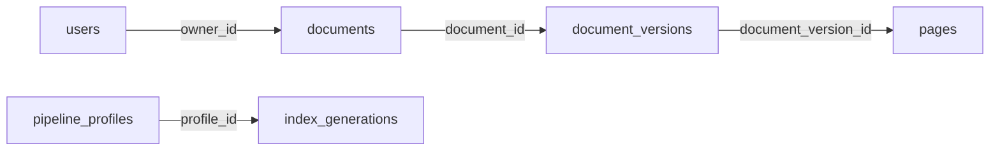

# 阶段1B-2：数据库与归属

日期：2026-11-06（北京时间）。本批已实现并验收。用户消息写“R05 / 1B-2”，为保留已有R05—R07历史，本次技术/口述记录使用连续编号**R08**；任务仍只做1B-2。

## 1. 当前实际数据

数据库位于独立项目`runtime/metadata.sqlite3`，Git忽略。SQLite本机文件不需要另开数据库服务，也不通过Docker运行。本轮只操作命令行，没有新增HTTP路由或改动网页。

| 数据 | 本轮实际结果 |
|---|---|
| User | admin为admin角色；A/B为user；均启用、首次改密标志为true、auth_version=1 |
| Document | tuGEMM归A，Music归B；均private、registered |
| DocumentVersion | 两个version=1，PDF哈希、项目相对路径、全页数及渲染身份已记录 |
| Page | tuGEMM 5页（0—4），Music 8页（0—7），共13页；对应全页图哈希、尺寸、路径 |
| PipelineProfile | colpali_full_v1配置JSON及规范化哈希，状态pending |
| IndexGeneration | 预留独立集合身份，page_count/vector_count均0，状态pending |

`registered`表示文件身份已登记，`pending`表示索引接入尚未验收，**不能当作检索ready**。没有创建Qdrant集合或写向量，没有加载模型。后端仍只有health路由。

## 2. 六张表之间如何连接



数据库生成UUID，不沿用开发清单中的短ID作业务主键。短文档ID保存在source_key，短页面ID保存在source_page_id，便于1B-4回溯旧特征身份；文件名不是主键。

- username使用NOCASE唯一约束，避免A/a成为两个账户；role仅admin/user。
- owner必须引用真实用户；版本必须引用真实文档；页面必须引用真实版本。
- 文档版本号在同文档内唯一，page_index在同版本内唯一，尺寸必须大于0。
- 文档的active_version_id通过复合外键，确保不能指向另一个文档的版本；该外键在事务结束时检查，允许同事务先建文档再建版本。
- 所有ORM连接开启foreign_keys、WAL和5000毫秒busy_timeout。外键防止悬空引用；WAL改善读写共存；busy_timeout使短暂锁竞争等待后再报错，不等于无限并发。
- 本批未建Session、任务、历史或区域表，按后续批次迁移增加。

## 3. 代码入口与迁移原理

| 文件 | 负责什么 |
|---|---|
| [connection.py](../backend/db/connection.py) | 数据路径限定在本项目runtime、连接及SQLite参数 |
| [models.py](../backend/db/models.py) | SQLAlchemy表模型和约束 |
| [0001_metadata.py](../migrations/versions/0001_metadata.py) | 冻结的第一版建表SQL及索引；不运行时读取模型来动态建表 |
| [migrations/env.py](../migrations/env.py) | Alembic连接和显式DDL事务 |
| [migrate_database.py](../scripts/migrate_database.py) | 将数据库升级到head，并保存alembic_version |
| [development_ownership.json](../configs/development_ownership.json) | 明确A/B归属及预期PDF哈希/页数；不是由目录或文件名推断owner |
| [seed.py](../backend/db/seed.py) | 验证文件、核对旧身份、事务内插入缺失元数据 |
| [initialize_database.py](../scripts/initialize_database.py) | 交互设置初始密码或生成本地随机凭据；不重置已有密码 |
| [inspect_database.py](../scripts/inspect_database.py) | 只读检查表数量、归属、完整性与外键，不输出密码或哈希 |

**模型与迁移的区别：**修改Python类不会自动修改已有数据库；本轮用Alembic的0001版本建表。后续改结构应新增迁移，不编辑已执行的0001去“修复”旧库。自动化测试比对模型与真实数据库，无结构漂移。

迁移和初始化分开，先升级结构再登记数据；不在Web启动时偷偷建表或导入语料。当前迁移不提供破坏性downgrade，错误降级会明确拒绝；若未来要回退，应先设计并核对SQLite与语料的备份恢复流程。

## 4. 实际执行与本人跟做

所有命令在项目根目录PowerShell执行：

```powershell
Set-Location 'C:/Users/WenJing/Documents/WorkTransfer/layoutpatch-system'
```

### 第一步：检查环境

```powershell
uv pip check --python .venv-web/Scripts/python.exe
```

本轮SQLAlchemy2.0.44、Alembic1.17.1、pwdlib0.3.0、pypdf6.1.3、Pillow12.0.0已安装到Web环境，全部25包兼容；原13个Web包版本没有变，模型`.venv`没有变。pypdf/Pillow只用于核对真实PDF和图像，不加载模型。

依赖已安装，日常不需要重建环境；只有确实需要恢复Web依赖时才执行：

```powershell
uv pip sync --python .venv-web/Scripts/python.exe requirements-web.lock.txt
```

### 第二步：迁移

```powershell
.venv-web/Scripts/python.exe -m scripts.migrate_database
```

`-m`按模块执行；默认项目runtime数据库；首次建表，重复执行检查版本，不重建/清空表。当前输出版本0001_metadata。不要把默认目标改为旧研究目录；脚本也会拒绝runtime之外的数据库路径。

### 第三步：初始化账号与归属

**本项目本轮已经初始化，以下可以重复执行验证不覆盖：**已有账号不会再问密码，已有记录只核对，不更新密码、角色、归属、标题、状态或UUID。

```powershell
.venv-web/Scripts/python.exe -m scripts.initialize_database
```

如果在一个新检查库初始化，首次默认在交互终端分别输入并确认admin/A/B初始密码（至少12字符，不回显）；密码不写命令参数，也不通过管道传入。

本轮无人值守初始化采用以下可选方式，随机临时密码保存到**新的本地文件**：

```powershell
.venv-web/Scripts/python.exe -m scripts.initialize_database --generate-credentials runtime/secrets/development-initial-passwords.json
```

该文件本轮已存在且被Git忽略，保留了三账号的临时密码；只在本人本机查看，不粘贴到聊天、报告或提交。数据库仅存Argon2id哈希。已有账号不会重生成密码，也不会覆盖此文件；已有账号密码若丢失，本CLI不能重置，重置机制留后续。

若初始化事务失败，已经独占创建的凭据文件可能仍在；它不表示账号已经建好。核对失败原因和数据库状态，使用新凭据文件路径重试，不覆盖原文件碰运气。重复执行遇到归属或不可变身份冲突会报错回滚，不自动纠正用户数据。

### 第四步：只读核对（建议你先练这一条）

```powershell
.venv-web/Scripts/python.exe -m scripts.inspect_database
```

脚本用SQLite只读连接；若库不存在会报错，不悄悄生成空库。输出应包含：

```text
revision: 0001_metadata
integrity_check: ok
foreign_key_violations: []
counts: users=3, documents=2, document_versions=2, pages=13,
        pipeline_profiles=1, index_generations=1
tuGEMM: owner=A, private, registered_pages=5, first=0, last=4
Music: owner=B, private, registered_pages=8, first=0, last=7
index: pending, page_count=0, vector_count=0
```

第0页对应用户看到的第1页。看不到页面或账号可能是查错数据库路径，先核对路径与迁移版本，不删库重来。

### 第五步：隔离库测试（可选练习，不改变正式开发数据）

```powershell
.venv-web/Scripts/python.exe -m unittest tests.test_database_initialization -v
```

测试在本项目runtime/verification临时目录运行，用真实SQLite和现有完整语料；退出后关闭连接并清理自身临时数据，不操作正式库或旧研究库。当前9项通过。它验证数据约束与初始化，不代表HTTP越权测试通过。

需要指定独立检查库时，迁移/初始化/检查三个命令都要传相同的`--database runtime/verification/你自己的目录/metadata.sqlite3`；不要只修改其中一条。

## 5. 为什么重复执行不会覆盖已有数据

初始化先校验2份PDF哈希和实际页数，再校验13张全页PNG的哈希、尺寸、格式及连续页序。未通过则不写库。文件核验在事务前完成，避免长时间占写锁。

写入使用BEGIN IMMEDIATE，两个初始化进程不会同时“看见缺失”再插入重复身份。数据库事务保证中途密码失败或归属冲突时整体回滚，不留下半套账号/文档。已存在账号不请求新密码，已存在标题/启用状态/改密标志不被恢复默认；不可变身份与预期不符时拒绝继续。

**本轮真实验证：**正式库连续执行迁移和初始化，第二次新增计数全部0；前后逻辑数据指纹一致，凭据文件不变，密码哈希可以校验对应临时密码。不能只看总行数相同就声称密码未重置。

## 6. 结果、失败与限制

[结构化验收](checks/stage1b-2-verification.json)记录正式数据、9项测试及限制；[开始快照](checks/source-state-r08-before.json)/[结束快照](checks/source-state-r08-after.json)一致，覆盖三旧库可检查状态、算法/模型锁和模型包版本，不包含ignored目录全盘哈希。

首次9项测试有6项在临时文件清理阶段报WinError32：SQLite的连接上下文处理事务但不会自动close。对只读检查和测试快照改用contextlib.closing后，全部通过；没有通过忽略清理错误来掩盖失败。外键循环排序提示用命名约束/use_alter处理，SQLite真实复合外键拒绝跨文档active_version的测试通过。

本轮未重建前端、重跑GPU或操作Qdrant。3000/8000/6333仍有本机监听（本轮已复核端口；未再次证明服务内容），未重启或终止这些服务。Web只读健康接口没有接入数据库。

**边界：**数据库owner_id不是HTTP授权；登录/会话/CSRF/越权防护留1B-3及后续，索引导入与真实query留1B-4。当前索引身份是pending，不得将本批写成登录检索已完成。

下一批只在用户明确继续后执行**1B-3：登录、改密、退出与会话撤销**。
