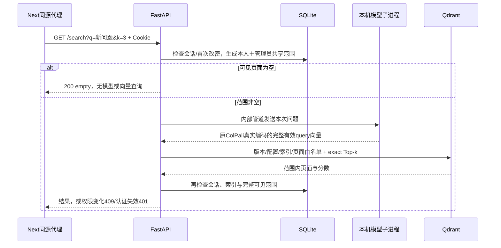

# 1B-4｜授权真实检索开发与学习

日期：2026-11-07，北京时间；轮次R10。范围为页面特征身份核验、Qdrant导入、受保护search和真实问题编码。登录/检索网页与授权图片预览属于1B-5，区域高亮属于后续阶段。本批证据见[汇总](checks/stage1b-4-verification.json)、[真实HTTP](checks/stage1b-4-http.json)、[官方评分](checks/stage1b-4-reference.json)、[正式库](checks/stage1b-4-formal.json)。过程及复述见[03](过程记录/03_1b技术操作详解.md#r10)、[04](过程记录/04_1b逐步口述稿.md#r10)。

## 1. 请求怎样变成授权范围内的结果



这里必须理解“先过滤再Top-k”：如果B的三页分数最高，而A只能看自己的五页，A仍应从自己的五页中取前三。先全库取三条再删除B的页面，会错误地给A空结果或少量结果，也可能泄露范围信息。后端从SQLite生成范围，客户端不能提交owner_id、profile_id或全库开关。

管理员的普通search也遵守“本人＋共享”，没有全库旁路。本批正式admin没有文档和共享库，完成首次改密后搜索会得到empty；跨用户管理检索仍待后续专用授权与审计。

## 2. 哪些代码各负责什么

| 文件 | 阅读重点 |
|---|---|
| [scope.py](../backend/search/scope.py) | 有效索引、profile身份、ready文档与IndexPage完整映射；共享仅允许启用管理员拥有的文档 |
| [routes.py](../backend/search/routes.py) | auth门禁、输入边界、空范围短路、真实调用、命中身份核对、返回前重新读取权限 |
| [qdrant.py](../backend/search/qdrant.py) | 显式REST请求；original/128维/Dot/MAX_SIM/exact，带白名单，不用prefetch或量化 |
| [worker.py](../backend/search/worker.py) | 单后端进程的一个持久模型子进程、串行锁、队列5秒与执行180秒上限、失败清理 |
| [model_query_worker.py](../scripts/model_query_worker.py) | 独立模型环境、离线原权重/实现哈希核验、每个问题一次实际forward，禁止网络连接 |
| [indexing.py](../backend/search/indexing.py) | 导入前核验来源/文件/数据库，回读向量确认后才激活，重复只核对 |
| [0003迁移](../migrations/versions/0003_search_pages.py) | IndexPage把页面绑定到索引代；索引增加特征文件和来源清单哈希 |

Web继续使用`.venv-web`已有依赖，Qdrant通过现有httpx调用。模型子进程使用独立`.venv`，没有往Web环境安装torch，也没有升级模型环境。内部stdin/stdout管道没有对浏览器开放的新端口；不扫描旧研究仓库，不读旧预测表作答案。

单个后端用`--workers 1`，模型按需启动并保持一份，查询串行；同问题再次提交也实际编码，没有查询向量缓存。worker冷启动还会核验已有权重哈希，需要一定时间。Next的proxyTimeout为240秒，高于后端有界等待；模型异常/超时或Qdrant失败返回503，不回放历史结果。

## 3. 页面特征为什么可以复用

来源是1A本项目生成的13页完整特征，路径`runtime/verification/20261105-gpu-first/page_embeddings.pt`。本轮对照被冻结的R03报告哈希、当前encoder profile、完整PDF/页面清单、图片哈希、连续页序、BF16张量的1031×128形状、有限值与单位范数。全部1031行进入页面检索；前1024是视觉patch，但本批不裁成1024行或做平均池化。

[development_features.json](../configs/development_features.json)记录来源文件哈希。**R03报告哈希在历史验收中已保存；页面pt文件本身的哈希是R10首次固定，不能声称它早在R03就已有独立校验。** 本批未重新编码13张页图，保留既有可信来源和核验限制。

安全加载使用`torch.load(..., weights_only=True, map_location='cpu')`。随后把BF16的精确数值转换为float32 JSON，提供给Web环境的导入CLI；每页另记JSON文件哈希和float32字节哈希。Qdrant回读时也还原成float32字节计算哈希，要求逐页一致。

这里修复过一次实际问题：Qdrant会把float32序列化为简短小数，Python按float64解析，列表直接相等会误报。恢复float32字节后比较避免这种表示差异；不是放宽检索评分容差。修改数据、维度、行数或profile仍会被拒绝。

## 4. 迁移和导入怎么跟做

以下在项目根目录PowerShell执行。**本轮正式操作已经完成时，日常不用重建索引。** 先运行只读检查；其余命令用于理解或恢复流程，不把阅读命令说成自己已执行。

```powershell
.venv-web/Scripts/python.exe -m scripts.inspect_database
```

正式预期：0003_search_pages、3账号、2文档、13页；A-tuGEMM5页、B-Music8页均private/ready；profile validated、index ready，page_count=13、vector_count=13403（13×1031个token向量，不是13403个页面）。IndexPage共13行。

导出命令必须给一个新的runtime目录，已存在就拒绝覆盖：

```powershell
.venv/Scripts/python.exe -B scripts/prepare_search_features.py --output runtime/indexes/自己的新导出目录
```

正式迁移/导入由下面脚本统一执行：先用SQLite backup API备份，再两次迁移，导入后再次核对，比较原密码、文档身份、文件与归属。它会改变正式库和正式Qdrant集合，学习时优先阅读脚本：

```powershell
.venv-web/Scripts/python.exe -m scripts.activate_development_index
```

底层命令可指定隔离库，前提是该库已迁移并完成账号/语料初始化：

```powershell
.venv-web/Scripts/python.exe -m scripts.migrate_database --database runtime/自己的练习库/metadata.sqlite3
.venv-web/Scripts/python.exe -m scripts.import_search_index --database runtime/自己的练习库/metadata.sqlite3 --features runtime/indexes/r10-features/manifest.json
```

隔离库的collection_name也必须使用独立名称，不能拿新UUID直接写正式集合。真实验收脚本已自动处理这件事，推荐通过它学习。现有集合只有全部数量、配置、ID、payload和向量核验一致才接受重复导入，不会自动删除/清空/覆盖它。失败会回滚SQLite，部分远端写入不会被标记ready；遇部分集合需核查后显式恢复，未开发自动断点续传。

正式操作保留原用户密码、首次改密标志、文档归属及页面身份；变更为ready/validated状态、新增索引来源和页面映射。正式初始密码仍在忽略的私密文件，不能粘贴到命令行参数或聊天。本批完整搜索使用隔离账号验收，正式账号首次改密仍由本人完成。

## 5. search接口与错误含义

浏览器路径`GET /api/search?q=问题&k=3`，后端路径`GET /search`。要求有效Cookie且已经首次改密。q去掉首尾空白后长度1—2000，k为1—50；额外参数与重复参数拒绝422。认证方法见[1B-3手册](stage1b-3-runbook.md)。

响应含status、profile_id、index_generation、scope_version、timings_ms和items。每项含document_id/document_version_id/page_id、从0开始page_index、从1开始page_number、document_name、page_rank/page_score、原图宽高/render_sha256、region_status=not_requested。没有物理文件路径、向量或模型秘密，也没有尚未实现的图片URL。scope_version是本次授权与索引快照的哈希，不是未来完整管理审计的access_epoch字段；本批不创建历史记录表或search_record_id。

| 结果 | 含义 |
|---|---|
| 200 ok | 从本次授权范围选出结果，返回前复核通过 |
| 200 empty | 验证过的索引存在，但当前用户可见页面为空；没有启动模型或查询Qdrant |
| 401 / 403 | 会话无效 / 首次改密未完成 |
| 409 SEARCH_SCOPE_CHANGED | 查询中归属/共享/版本/索引/角色变化，旧结果丢弃，可重新发起 |
| 422 INVALID_REQUEST | 问题、k、额外参数或重复参数非法 |
| 503 SEARCH_UNAVAILABLE | 索引未就绪/身份异常、数据库/模型/向量库不可用或命中不可信 |
| 503 MODEL_BUSY | 5秒内未获得串行编码锁，带Retry-After |

search成功和错误均`private, no-store`及`Vary: Cookie`。HTTP接口使用GET，启动Uvicorn要加`--no-access-log`避免把完整问题写入普通访问日志；代理故障日志仍可能记录请求URL，本批失败日志只含开发测试问题，正式部署需另审代理日志策略。

## 6. 本人可复现的检查

快速隔离测试不占GPU、不改正式库，模型和Qdrant使用明确的测试替身检验错误/竞态契约：

```powershell
.venv-web/Scripts/python.exe -m unittest tests.test_search tests.test_auth tests.test_database_initialization -v
```

真实验收使用现有GPU和Qdrant，自建随机账号、独立SQLite/唯一集合，启动生产Next/Uvicorn，结束清理自己的进程与测试集合；报告在docs/checks，原始材料在忽略目录。需要3000/8000空闲，遇占用直接拒绝；先核对身份再停止已有本项目服务。它会实际终止自己启动的模型进程来验证503，不会终止用户其他GPU任务。

```powershell
corepack yarn --cwd frontend typecheck
corepack yarn --cwd frontend build
.venv-web/Scripts/python.exe -m scripts.check_search_http
```

验收用两个新编写的问题，重复提交也新forward；共享场景单建管理员文档，不将A/B私有文档变共享来掩盖隔离。对照本轮worker实际输出的query向量，用官方ColPaliProcessor和CPU float32 MaxSim计算；预设atol=1e-4、rtol=1e-5，非并列排名一致。共享测试有重复特征，允许并列项相互交换，但要求Top-k分数集合一致。

初始化SDK的命令已执行，生成SearchService，不手改generated代码：

```powershell
.venv-web/Scripts/python.exe -m scripts.export_openapi
corepack yarn --cwd frontend gen:sdk
```

当前环境沙箱曾拒绝已有Argon2 DLL加载，隔离测试和服务类命令需经工具批准在沙箱外运行；这不代表缺包，不应据报错重装或升级模型环境。一次编辑命令默认GBK读中文失败，改显式UTF-8；失败和最终检查均在本轮记录。

## 7. 启停与配置

后端在根目录、前端在frontend目录分别启动；端口已占用时不要重复启动：

```powershell
.venv-web/Scripts/python.exe -m uvicorn backend.main:app --host 127.0.0.1 --port 8000 --workers 1 --no-access-log
```

```powershell
node node_modules/next/dist/bin/next start --hostname 127.0.0.1 --port 3000
```

Qdrant连接只允许显式127.0.0.1 HTTP端口。QDRANT_URL从进程环境读取，默认6333；key优先进程QDRANT_API_KEY，缺省只读取项目.env里的同名单项，不加载整个.env。模型路径固定来自既有缓存revision，Web进程不能从用户请求更换模型、Python或输出路径。

`LAYOUTPATCH_QUERY_AUDIT_DIR`仅用于本机验收，必须在runtime内；设置后保存query哈希/向量/计数/模型进程号及耗时，不保存原问题或凭据。正式启动默认不设置；这不等同于后续用户可见历史。停止使用所属终端Ctrl+C，后端lifespan会释放子进程；PID操作前核对身份。模型没有独立HTTP服务。

本批边界：受保护真实检索HTTP已经建立，1B-5还需登录/改密/检索网页与授权图片；不把本批当整个1B验收。旧库只读、模型/算法锁与原包版本保持，未训练、换底座或下载模型。完成本批后停止。
