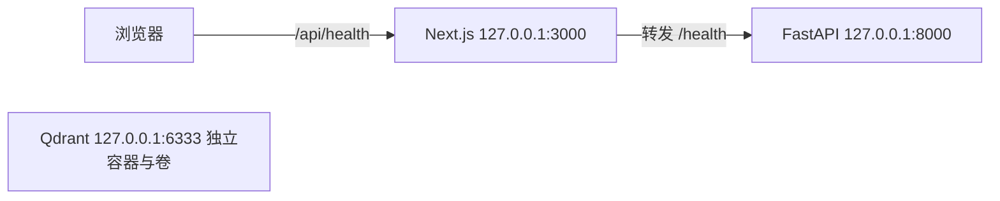

# 03｜阶段1B技术操作详解与开发学习

更新：2026-11-07（北京时间）。当前**1B-1至1B-4已通过**，1B-5及以后尚未实施。本文件承接原01的R05、R06，后续1B操作继续在此追加，配套[04口述稿](04_1b逐步口述稿.md)。本批学习见[1B-4手册](../stage1b-4-runbook.md)及[R10](#r10)。

先读开发学习，再看真实历史。**学习命令供本人理解和练习，不代表本轮重新执行**；R07只整理文档，没有安装依赖、启动服务或重新验收。上轮运行态见[交接](../AI交接.md)，练习前要重新检查。

## 一、三个服务分别做什么



上图为1B-1健康骨架学习图。R10已接入Qdrant授权检索HTTP，最新链路见1B-4手册；现有网页按钮仍只检查health。

| 技术 | 本批作用 | 对应文件 |
|---|---|---|
| FastAPI | 定义HTTP路径和响应格式 | [main.py](../../backend/main.py) |
| Uvicorn | 运行FastAPI、监听端口 | [Web依赖](../../requirements-web.in) |
| Next.js / React | 网页、按钮状态、API转发 | [page.tsx](../../frontend/app/page.tsx)、[next.config.ts](../../frontend/next.config.ts) |
| TypeScript | 构建前检查类型 | [package.json](../../frontend/package.json) |
| OpenAPI / SDK | 从接口定义生成客户端调用代码 | [导出脚本](../../scripts/export_openapi.py)、[生成服务](../../frontend/lib/api/generated/services/SystemService.ts) |
| Qdrant / Docker | 独立向量库服务；目前为空库 | [compose.yaml](../../compose.yaml) |

## 二、按开发顺序学习

<a id="l01"></a>

### L01｜定位项目，检查改动和端口

打开PowerShell，进入项目根目录；以下未注明位置的命令都在根目录执行：

```powershell
Set-Location 'C:/Users/WenJing/Documents/WorkTransfer/layoutpatch-system'
Get-Location
git status --short
Get-NetTCPConnection -State Listen -ErrorAction SilentlyContinue |
  Where-Object LocalPort -in 3000,8000,6333 |
  Select-Object LocalAddress,LocalPort,OwningProcess
```

`Set-Location`切换工作目录，防止写到旧仓库；`git status`看已有修改，不执行清理。端口检查有输出表示存在监听，`OwningProcess`是进程号。没有输出时也要留意命令是否本身失败。

**判断：**本项目已运行就直接检查连接，不要重复启动相同端口。不认识的进程先核实身份，不能照抄历史PID结束进程。`127.0.0.1`只绑定本机。

**自检：**为什么先确定目录？为什么看到3000已监听时不能再启动一个前端？

<a id="l02"></a>

### L02｜隔离环境，理解锁文件

`.venv`用于原ColPali，`.venv-web`用于HTTP后端，`frontend/node_modules`保存前端依赖。Web依赖单独安装，避免改变已通过1A的模型环境。

```powershell
# 查看已有Web环境
.venv-web/Scripts/python.exe --version
uv pip check --python .venv-web/Scripts/python.exe
# 仅在需要恢复Web依赖时执行，日常启动不必安装
uv pip sync --python .venv-web/Scripts/python.exe requirements-web.lock.txt
corepack yarn --cwd frontend install --frozen-lockfile --non-interactive
```

`--python`明确目标环境；`sync`按锁文件同步，可能移除锁外包，不能指向模型环境。`--cwd frontend`切换Yarn工作目录；`--frozen-lockfile`防止随意重写锁；`--non-interactive`避免等待交互。

只有`.venv-web`确实不存在时才创建，不要重建已有环境：

```powershell
uv venv .venv-web --python .venv/Scripts/python.exe
```

[requirements-web.in](../../requirements-web.in)写直接依赖，`.lock.txt`写解析后的完整版本；前端`package.json`定义依赖/命令，`yarn.lock`固定实际解析版本。依赖变更才重新解析锁，不为启动系统升级模型包。

**历史结果：**R05安装13个Web包并通过冻结安装。本轮R07未重新安装。

<a id="l03"></a>

### L03｜读懂最小健康接口

打开[backend/main.py](../../backend/main.py)，按顺序对照：

1. `app = FastAPI(...)`创建应用对象。
2. `HealthResponse(BaseModel)`定义响应结构；`Literal["ok"]`限定status值。
3. `@app.get("/health", ...)`注册GET路径；`operation_id="get_health"`给客户端生成提供稳定标识。
4. `return HealthResponse()`返回JSON：`{"status":"ok"}`。
5. `Cache-Control: no-store`要求响应不缓存，避免看见旧状态。

GET用于读取；HTTP200说明请求成功。该文件没有导入模型或连接Qdrant，所以它证明进程能响应，不证明整个业务正常。框架默认还提供OpenAPI/docs，不等于已经开发登录/检索路由。

**练习：**在代码里分别指出路径、响应类型和缓存设置；本批不用修改代码。

<a id="l04"></a>

### L04｜生成SDK，理解按钮如何改变文字

接口发生变化后，按以下顺序更新客户端：

```powershell
.venv-web/Scripts/python.exe -m scripts.export_openapi
corepack yarn --cwd frontend gen:sdk
corepack yarn --cwd frontend typecheck
```

第一条导入后端app，写入`frontend/docs/openapi.json`，不必先启动HTTP服务；`-m`按模块运行脚本。第二条执行`package.json`里的生成命令，写入`frontend/lib/api/generated`；第三条执行`tsc --noEmit`，检查类型但不生成编译文件。

不要手改生成目录，下次生成会覆盖。应修改后端定义或[客户端配置](../../frontend/lib/api/client.ts)。`OpenAPI.BASE = "/api"`使浏览器走同源路径。

再读[page.tsx](../../frontend/app/page.tsx)：`"use client"`允许浏览器交互；`useState`保存显示状态；点击调用`check()`，先显示“检查中”；`await SystemService.getHealth()`等待真实响应，成功更新状态，失败由`catch`显示提示。`role="status"`与`aria-live`方便辅助技术感知状态变化。

**自检：**按钮文字为什么会变化？接口修改后为什么要重新生成SDK？为什么不能把Qdrant key写进前端？

<a id="l05"></a>

### L05｜代理配置与前后端启动

[next.config.ts](../../frontend/next.config.ts)将3000上的`/api/:path*`转发到8000上的`/:path*`，所以浏览器请求`/api/health`，后端接收`/health`。源由协议、主机和端口共同决定；不同端口是不同源，代理让浏览器统一访问3000。

先做L01，服务已运行就不要重复启动。需要启动时，开两个PowerShell窗口，都进入项目根目录。

**窗口A，运行后端：**

```powershell
.venv-web/Scripts/python.exe -m uvicorn backend.main:app --host 127.0.0.1 --port 8000 --workers 1
```

`backend.main:app`表示导入`backend/main.py`里的app；`--host`绑定地址；`--port`指定端口；`--workers 1`只开一个后端工作进程。成功后命令持续占用窗口，保留它。

**窗口B，选择一种前端模式：**开发时运行下面命令，便于观察代码修改：

```powershell
corepack yarn --cwd frontend dev
```

生产模式先build再start，不要与dev同时占用3000：

```powershell
corepack yarn --cwd frontend build
corepack yarn --cwd frontend start
```

`build`生成产物；`start`读取产物运行。改源码后生产产物不会自动更新，需要重新build。R05正式验收采用生产模式。

<a id="l06"></a>

### L06｜分段验证HTTP，再点击网页

另开一个PowerShell窗口：

```powershell
Invoke-RestMethod http://127.0.0.1:8000/health
Invoke-RestMethod http://127.0.0.1:3000/api/health
```

两条应得到`status=ok`；第一条直连后端，第二条验证代理。再打开[本机页面](http://127.0.0.1:3000)，点击“检查连接”，应显示“服务连接正常”。

| 观察 | 优先排查 |
|---|---|
| 8000失败 | 后端窗口、工作目录、端口 |
| 8000成功但代理失败 | 前端运行状态、代理目标 |
| HTTP都成功但按钮失败 | 当前页面构建、SDK配置、浏览器请求错误 |
| 按钮成功 | 仍需独立检查Qdrant，不能推断向量库就绪 |

R06已实际点击成功，[截图证据](../checks/r06-browser-health.png)可查看。Cookie、CSRF与二进制转发留对应业务批次验证。

<a id="l07"></a>

### L07｜理解并验证独立Qdrant

读[compose.yaml](../../compose.yaml)：`name`指定项目；`services.qdrant`定义服务；镜像标签表示版本，SHA256摘要标识具体镜像内容；`127.0.0.1:6333:6333`将宿主本机端口转发到容器端口。镜像是模板，容器是运行实例，数据卷保存独立数据，当前卷挂载到`/qdrant/storage`。

服务要求API key，Compose从根目录`.env`读取；key不进前端。已有`.env`不要重建；[初始化脚本](../../scripts/init-local.ps1)只在文件不存在时创建随机key，拒绝覆盖。不要打印或粘贴key，配置校验用quiet模式。

```powershell
docker info --format '{{.ServerVersion}}'
docker compose config --quiet
docker compose up -d qdrant
docker compose ps
.venv-web/Scripts/python.exe -m scripts.check_qdrant
```

`config --quiet`只校验配置；`up -d`创建或启动后台服务；`ps`看本项目容器。检查脚本读本地key并向真实服务发请求，不输出key。

**预期：**ready200、authorized200、anonymous401、wrong_key401、collections为空。匿名及错误key得到401正是验收目标；正确key仍被拒才需排查。本批未导入向量，所以不能说检索已完成。

R05遇到过引擎连接失败，R06实查已恢复，恢复原因未核实。不能把旧失败当当前状态，也不要随意清理旧卷或全局prune。

<a id="l08"></a>

### L08｜停止、重启与阅读验收报告

原生前后端分别在启动窗口按Ctrl+C，不照抄旧PID。Qdrant用项目范围命令：

```powershell
docker compose stop qdrant
docker compose ps -a
docker compose up -d qdrant
.venv-web/Scripts/python.exe -m scripts.check_qdrant
```

停止保留卷，不删除数据；重启必须再检查，不能只凭Started日志。R06停止退出码为143，对应SIGTERM；同时确认容器exited、端口关闭、无OOM/error并能重启，才判断停止验收通过。不能推导为所有143都无需检查。尚未写入业务向量，也没有证明非空数据持久性。

自动前后端生命周期检查需要自行占用3000/8000，**先停止自己启动的前后端**才运行：

```powershell
.venv-web/Scripts/python.exe -m scripts.check_web_skeleton
```

脚本启动并结束其创建的进程，连续两轮12项；会更新报告与日志，属于重新验收。本轮R07未运行。只想学习则直接读[已有Web报告](../checks/stage1b-1-web.json)、[Qdrant报告](../checks/r06-stage1b-1-completion.json)。

## 三、本人学习自检

- [ ] 能说明两个Python环境和锁文件的作用。
- [ ] 能在代码中指出health路由、响应、SDK调用和代理位置。
- [ ] 能按浏览器→SDK→代理→后端复述请求路径。
- [ ] 能选择dev或build/start，知道在哪个窗口停止服务。
- [ ] 能解释200、401、镜像摘要及独立卷。
- [ ] 能找到真实证据，并明确登录、检索与高亮尚未开发。

第一次建议只练L01、L06的查看与连接检查，理解后再练启动停止。由本人理解后勾选，不由AI代勾。常用命令汇总见[运行手册](../stage1b-1-runbook.md)。

## 四、真实开发历史

以下保留R05/R06的日期、编号和当时结果。R05的阻塞和下一步是历史状态，当前通过结论以R06为准。


<a id="r05"></a>

## 2026-11-06｜R05｜1B-1独立运行骨架

**目标：**仅实现运行骨架；前后端通过、Qdrant阻塞，整批未全通过。仅在独立系统项目写入，未开发登录、检索或高亮，未下载模型、训练、改底座或提交推送。

<a id="r05-s01"></a>

### R05-S01｜核实现状与隔离依赖〔已检查／已修改〕

- 读取根AGENTS、AI交接、架构、接口、来源与历史过程记录；核对Git现有修改，保留用户已有README、progress、过程记录及未跟踪交接文件，不清理或覆盖旧研究库。
- 初始无Web代码、3000/8000/6333空闲；模型`.venv`无pip，不在其中安装Web包。用现有uv和Python3.11.16创建`.venv-web`，安装FastAPI0.121.0/Uvicorn0.38.0及锁定的13包；生成`requirements-web.lock.txt`。
- `scripts/snapshot_sources.py before/after`记录三源库HEAD、Git状态、已有变化文件哈希和模型包版本/算法锁文件，前后相同。开始快照在新增骨架/Web安装后取得；不冒充全程全盘哈希，ignored旧目录未穷举。
- 首次大段批量写入命令被执行策略拒绝、未执行；随后改用文件补丁及较小命令完成。本轮没有因此申请额外权限。

<a id="r05-s02"></a>

### R05-S02｜建立健康接口、壳页与生成SDK〔已实现／已检查〕

- 新增`backend/main.py`，只挂载health（另有框架默认OpenAPI/docs），返回最少存活信息、no-store，不导入模型或业务。
- 新增`frontend/`最小Next16.0.7/React19.2.0/TypeScript壳页，连接按钮调用生成SDK；`next.config.ts`把`/api/*`转发本机8000，浏览器不直接跨域访问后端。
- 选择性沿用Snappy的Yarn Classic锁、框架版本与OpenAPI代码生成机制；依赖按最小集合裁剪，保留MIT及源路径/提交/哈希/差异，见[来源清单](../checks/r05-provenance.json)。未复制旧聊天、OCR、清库或公开文件路由。
- `.venv-web/Scripts/python.exe -m scripts.export_openapi`导出接口，`corepack yarn --cwd frontend gen:sdk`生成客户端；不能手改生成文件。未来Cookie/CSRF/Range仍需对应业务实测。

<a id="r05-s03"></a>

### R05-S03｜配置独立Qdrant并记录引擎失败〔配置通过／运行阻塞〕

- `compose.yaml`固定Qdrant v1.16.2，项目独立命名与卷、仅127.0.0.1:6333、API key、关闭遥测；`scripts/init-local.ps1`生成随机32字节key进入忽略的`.env`，拒绝覆盖、无输出key。
- `docker compose config --quiet`退出0，但`docker info`、`docker compose up -d qdrant`失败：Linux引擎管道不存在；Desktop start/status挂起，restart限时调用未恢复，随后清理本轮挂起CLI调用（未终止Docker Desktop全局服务）。
- 宿主日志北京时间02:10:29显示Ingest server的`sailor-ingest.sock`重命名不可访问。只确认该日志错误，底层原因待核实；未删除系统socket、重置Docker、shutdown WSL或碰旧卷。
- 新增`scripts/check_qdrant.py`，待真实服务恢复后检查ready、正确key、匿名/错误key拒绝；目前未执行通过。镜像未拉取，摘要与停止/重启尚无证据，不以配置通过代替就绪。

<a id="r05-s04"></a>

### R05-S04｜生产构建与两轮真实HTTP生命周期验收〔已验证〕

- `corepack yarn --cwd frontend typecheck`、`build`退出0；再次`install --frozen-lockfile --non-interactive`成功。兼容浏览器数据过期提示保留，未升级无关包。
- `.venv-web/Scripts/python.exe -m scripts.check_web_skeleton`自行启动单worker后端和生产前端，连续两轮各6项通过：直接/代理health200且JSON相同、代理no-store、壳页HTML、OpenAPI仅health、停后端代理500、停止释放端口。记录见[12项证据](../checks/stage1b-1-web.json)，原日志在`runtime/verification/r05/`。
- 检查只终止工具自己创建的PID树，不杀用户进程。结束Web服务已停止，3000/8000释放。未运行浏览器按钮点击或视觉QA；未验证登录、搜索、Cookie、文件流、Qdrant或GPU服务。

<a id="r05-s05"></a>

### R05-S05｜同步交接、复现与学习记录〔已记录〕

- 新增[运行手册](../stage1b-1-runbook.md)说明安装、导出/生成、生产/开发启动、Ctrl+C停止、两轮验收、Qdrant后续真实检查及禁止删卷操作。
- 及时更新AI交接实施中状态，收尾同步README、progress、architecture、interfaces和本两份过程记录，保留既有1A及R04历史；`.env.example`注明仅key由Compose消费。
- [总状态](../checks/stage1b-1-status.json)明确前后端通过、Qdrant阻塞。模型锁/算法及模型包版本与三旧库可检查状态相同；未重跑GPU推理。
- [收尾检查](../checks/r05-document-checks.json)：Python语法、5对编号、口稿60—100字、运行手册/交接链接与JSON通过；git diff --check通过（仅CRLF提示），敏感/运行目录忽略有效，三个端口无监听。
- 本轮停止在1B-1，下一轮先解除Docker并补齐Qdrant验收，不自动进入1B-2。

<a id="r06"></a>

## 2026-11-06｜R06｜补齐1B-1独立运行骨架验收

**目标：**用户要求重新实查Docker并完成1B-1；不推进1B-2。本轮未修复或重置Docker，实际引擎已正常。

<a id="r06-s01"></a>

### R06-S01｜重新核实现状与保护历史证据〔已验证〕

- 先读根AGENTS与AI交接，再核对runbook、Compose、检查脚本、Git差异与端口。`docker info --format '{{.ServerVersion}}'`真实返回29.8.0，本项目容器/卷不存在，3000/8000/6333无监听。
- 这次结果取代“当前仍阻塞”的判断；R05日志失败保留，底层原因与恢复原因均未确定，不宣称本轮修好了Docker。
- `snapshot_sources.py`增加可选轮次参数；执行`python scripts/snapshot_sources.py before r06`和`after r06`保存独立证据，避免覆盖R05。三旧库HEAD/状态/变更文件哈希、算法/模型锁与模型包版本前后相同；不穷举ignored旧目录。
- 重要阶段及时追加交接进展；原`stage1b-1-status.json`先原样归档为`r05-stage1b-1-status.json`，当前文件仅汇总最新状态和历史入口。

<a id="r06-s02"></a>

### R06-S02｜独立Qdrant就绪、密钥与停止重启验收〔已验证〕

- `docker compose config --quiet`通过，`docker compose up -d qdrant`拉取普通Qdrant镜像（非模型），创建本项目网络、卷和容器；未操作旧研究栈或旧卷。
- 首次`scripts.check_qdrant`返回ready200、正确key200、匿名401、错误key401、集合为空；Docker检查确认只有127.0.0.1:6333映射，挂载独立卷`layoutpatch-system-qdrant-data`到`/qdrant/storage`，未暴露6334，key未打印。
- 将Compose镜像固定为`qdrant/qdrant:v1.16.2@sha256:dab6de32f7b2cc599985a7c764db3e8b062f70508fb85ca074aa856f829bf335`；固定摘要防止标签后来指向其他内容。
- **失败与修正：**初次停止额外要求ExitCode=0的断言失败；随即独立复测得exited、Running=false、ExitCode143、OOMKilled=false、Error为空、6333不可连接。143为接收SIGTERM后的退出，不应只凭非零误判服务仍在运行。后续up重新启动并再次通过全部HTTP/密钥检查。
- 首次、固定摘要后、停止及重启结果分别保存在`r06-qdrant-first-start.json`、`r06-qdrant-after-pin.json`、`r06-qdrant-stop.json`、`r06-qdrant-restarted.json`；汇总见[本轮验收](../checks/r06-stage1b-1-completion.json)。未创建业务集合/向量，不声称非空数据持久性或检索评分已验证。

<a id="r06-s03"></a>

### R06-S03｜浏览器连接检查与交接收尾〔已验证／已记录〕

- 使用computer-use技能及浏览器接口启动本项目已有生产前后端，在IAB访问本机3000；实际点击“检查连接”，文本由“尚未检查”变为“服务连接正常”。保存[浏览器截图](../checks/r06-browser-health.png)，窄视口下标题、状态、按钮可见。
- Web实现本轮未变；沿用R05类型/构建及两轮12项HTTP生命周期证据，不为补齐Qdrant重复GPU或全量Web测试。浏览器只证明壳页到health的真实调用，不证明登录、检索或区域高亮。
- 更新AI交接、运行手册、README、progress、architecture、interfaces及两份过程记录。当前1B-1通过，1B-2仍未开始。
- **交接运行态：**前端127.0.0.1:3000（PID50056）、后端127.0.0.1:8000（PID51084）、Qdrant127.0.0.1:6333保留运行供查看；原生终端Ctrl+C，或先核验PID命令行再停止；Qdrant用`docker compose stop qdrant`保留卷。停止与重启命令见runbook。
- [收尾检查](../checks/r06-document-checks.json)通过：3对步骤、每步97字口稿、JSON/链接/脚本语法；git diff --check无错误；密钥和运行目录仍被Git忽略，最终直接与代理health均为ok、Qdrant仍运行。
- 未下载模型、训练、改底座、写旧仓库、提交或推送。下一批1B-2等待用户明确继续。


<a id="r07"></a>

## 2026-11-06｜R07｜建立1B学习专册

**范围：**仅整理文档与维护入口，1B-2未开始。核实用户已新建空白03/04，使用现有文件，不新建重复doc目录。

<a id="r07-s01"></a>

### R07-S01｜迁移1B历史并统一维护入口〔已修改〕

- 先读AGENTS和AI交接，再核对01/02中的R05/R06、用户新建03/04、相关代码和Git状态；确认03/04长度均为0后填充。
- 完整迁入R05/R06的8个技术步骤及对应口述，保留日期、失败、验收限制与证据链接。只修正口述指向技术专册的相对路径；01/02保留各历史锚点及跳转，不保留两份会漂移的正文。
- AGENTS、AI交接、README同步入口，后续1B只维护03/04。原始证据仍放docs/checks，不复制密钥或运行数据。
- 首次长命令被执行策略拒绝且未运行，改用文件补丁与短命令完成；未要求额外授权，未改应用实现。

<a id="r07-s02"></a>

### R07-S02｜补充八步开发学习并检查〔已修改／已核对〕

- 对照当前main.py、page.tsx、SDK配置、代理、导出与初始化脚本、package.json和Compose，编写L01—L08：目录/端口、环境/锁、健康接口、SDK/按钮、启动/代理、HTTP/浏览器、Qdrant、停止/重启。
- 每步写执行目录、命令参数、预期结果、代码解释及自检；04增加对应八段复述和追问。明确安装/自动验收会改变环境或报告，当前运行服务不能重复占端口；练习不等于本轮已执行。
- 本轮没有重新安装、启停服务、浏览器操作或运行应用测试；R06服务运行态仅作历史引用，不当作新验证。没有写旧研究库、下载模型、训练、提交或推送。
- 文档链接/锚点、步骤配对、口稿长度、迁移完整性与应用文件哈希检查结果见[质量记录](../checks/r07-document-checks.json)。

本轮结束：1B-1已通过的历史结论不变，学习资料已归入03/04；下一开发批仍为1B-2，等待用户继续。

<a id="r08"></a>

## 2026-11-06｜R08｜1B-2数据库与归属

**本批目标：**建立账号、文档版本、页面与索引身份，迁移和初始化可重复执行。用户消息写R05/1B-2，历史R05已用于1B-1，因此本轮连续编号R08；范围未扩大。只做数据库与归属，不做登录、检索或高亮。

完整开发学习与命令见[1B-2手册](../stage1b-2-runbook.md)。本节记录实际操作，下面学习命令除特别注明均已在本轮执行。

<a id="r08-s01"></a>

### R08-S01｜核实现状、冻结边界与补齐数据依赖〔已操作／已验证〕

- 先读AGENTS/AI交接，再读架构、权限、03记录、完整语料清单和生成脚本。Git已有变动保留；正式runtime内没有SQLite业务库。
- 执行`python scripts/snapshot_sources.py before r08`建立旧库与模型边界快照。读取清单确认两份完整PDF共13页，明确tuGEMM归A、Music归B，不按gold筛页。
- Web环境增加SQLAlchemy2.0.44、Alembic1.17.1、pwdlib[argon2]0.3.0、pypdf6.1.3、Pillow12.0.0。用旧Web锁作约束解析，再sync到`.venv-web`；25包依赖检查通过，原13包版本不变，未操作模型环境。
- 理解：SQLAlchemy连接Python对象和表；Alembic记录数据库结构版本；pypdf/Pillow在不加载模型的情况下核对PDF/PNG。依赖恢复用`uv pip sync --python .venv-web/Scripts/python.exe requirements-web.lock.txt`，日常不重复安装。

<a id="r08-s02"></a>

### R08-S02｜建立六表与冻结迁移〔已实现／已验证〕

- 新增`backend/db/connection.py`、`models.py`和Alembic配置/环境/`0001_metadata`。六表为users、documents、document_versions、pages、pipeline_profiles、index_generations；会话/任务/区域表不提前实现。
- UUID作业务身份，开发清单短ID另存映射。用户角色与大小写无关唯一名、owner外键、文档版本唯一、页序唯一、合法尺寸等由数据库约束；active_version复合外键禁止跨文档引用，事务提交时检查。
- 每个ORM连接启用foreign_keys、WAL、5000ms busy_timeout；迁移显式BEGIN IMMEDIATE并以事务执行冻结SQL和版本记录。当前只支持向前升级，拒绝破坏性downgrade；后续改表需新增迁移。
- 实际在检查库执行`.venv-web/Scripts/python.exe -m scripts.migrate_database --database runtime/verification/r08/migration-check.sqlite3`，6表和alembic_version建立，FK=1、journal=wal；正式库随后也通过迁移。
- 理解：只改models.py不会改变旧数据库；先migration再seed，把“改结构”和“登记数据”分开。迁移不是重建或清空数据库。

<a id="r08-s03"></a>

### R08-S03｜完整文件核验与事务初始化〔已实现／已执行〕

- 新增`configs/development_ownership.json`明确A/B归属、两PDF预期哈希/页数；`backend/db/seed.py`先核验两PDF哈希和实际页数、13张全页PNG哈希/尺寸/格式及连续页序，再进入写事务。
- 新增初始化CLI，缺失才建、已存在只核对或保留，冲突报错不覆盖。BEGIN IMMEDIATE串行化并发初始化；中途异常回滚整批数据。初始密码默认交互输入并确认，不回显、不走参数；Argon2id仅存哈希。
- 正式库执行迁移后，使用`python -m scripts.initialize_database --generate-credentials runtime/secrets/development-initial-passwords.json`（实际使用`.venv-web/Scripts/python.exe`）。随机临时密码只保存在本项目忽略文件，输出不含秘密，三账号must_change_password=true；已有文件不覆盖。
- 实际新增3账号、2文档、2版本、13页、1profile、1index。A-tuGEMM5页、B-Music8页均private/registered。profile与index为pending、索引计数0；没有Qdrant操作或模型推理。
- 理解：文档登记不等于完成向量索引；pending避免把尚未接入的向量库身份伪装为ready。随机密码文件仍属本机私密资料，不能贴入聊天或提交。

<a id="r08-s04"></a>

### R08-S04｜测试失败定位、约束与重复执行检查〔已验证〕

- 新增9项真实SQLite测试：重复迁移/结构无漂移、完整语料归属及密码验证、重复保留标题/账号状态/密码/UUID、归属冲突全回滚、6种错误语料、7条非法SQL、密码失败回滚、并发初始化、CLI凭据生成与重复保护。
- 首次9项中6项在tearDown报WinError32，原因是sqlite3连接上下文处理事务但不close。只读检查及测试快照改用`contextlib.closing`显式关闭；复测9项全通过，用时3.057秒。没有忽略清理错误。
- Alembic path_separator警告补配置，元数据循环排序通过命名外键/use_alter处理；跨文档active_version的真实SQLite拒绝测试通过，未取消外键约束。
- 正式开发库再次执行迁移和初始化，新增计数全0，数据库逻辑内容指纹和凭据文件哈希不变；实际用对应随机密码核验Argon2哈希通过，未输出密码/哈希。不能只用行数证明未重置密码。
- 检查命令：`.venv-web/Scripts/python.exe -m unittest tests.test_database_initialization -v`；测试库在runtime/verification隔离目录，不动正式数据。失败与通过均记录在[结构化验收](../checks/stage1b-2-verification.json)。

<a id="r08-s05"></a>

### R08-S05｜只读验收、学习入口与交接〔已验证／已同步〕

- 新增`inspect_database.py`只读连接，输出迁移版本、完整性、外键、数量与归属，不输出密码或哈希。实际正式库integrity_check=ok、foreign_key_check为空，页序0—4/0—7，共13页，pending索引无向量。
- 本人建议先练`.venv-web/Scripts/python.exe -m scripts.inspect_database`，对照手册里的预期，口述“owner→document→version→page”；不必为了学习重建库或重跑GPU。
- R08结束快照与开始相同；三旧库可检查状态、算法/模型锁、模型包版本均未变（不是ignored目录全量哈希）。库和临时密码文件均被Git忽略，未提交/推送。
- 更新AI交接、README、progress、architecture、env说明以及03/04；数据验证不等于HTTP隔离，Web仍只有health。未重新构建前端或运行模型，不操作Qdrant。
- 本轮实查3000/8000/6333仍仅本机监听；未重启/终止，端口存在不当作新业务验收。下一批为1B-3，等用户继续。

R08收尾：[文档质量检查](../checks/r08-document-checks.json)通过，五对步骤、60—100字口稿、链接/语法有效，正式库22个UUID合法且唯一；为确保从零建立测试目录并避免失败输出泄露哈希，测试小修后再跑9项通过（2.926秒），日志保存runtime/verification/r08/unittest-final.log。此前3.057秒为首次修复后的通过记录。

<a id="r09"></a>

## 2026-11-07｜R09｜1B-3认证与会话

**本批目标：**只做登录、首次改密、退出、角色检查和会话撤销。先核对AGENTS/交接/1B-2正式库，再按本批代码和接口设计实施；不开发登录网页、检索或高亮。学习命令及原理集中在[1B-3手册](../stage1b-3-runbook.md)，下面区分实际操作、失败与后续设计。

<a id="r09-s01"></a>

### R09-S01｜冻结边界、依赖与会话迁移〔已实现／已核验〕

- 核实正式库0001已有3账号、2份私有文档共13页、pending索引；初始密码只在忽略目录。建立source-state-r09-before快照，不把上轮记录当新证据。
- 用原Web锁作约束加入starsessions2.2.1、httpx0.28.1及必要传递依赖；Web共30包、原25包版本不变，uv pip check通过。模型环境不安装包、不加载模型，未操作Qdrant业务。
- 新增AuthSession/LoginAttempt及冻结迁移0002_auth，不修改0001；会话存SHA256 ID、user_id/auth_version、CSRF与时间/撤销状态，失败限速存哈希主体/窗口/计数。迁移命令为`.venv-web/Scripts/python.exe -m scripts.migrate_database`，正式库迁移在S04备份后执行。
- 理解：Cookie不是用户数据库，不能只在登录时查一次账号。auth_version是撤销全部旧会话的版本闸门；数据库哈希不能直接用作Cookie。只有登录能创建会话行。

<a id="r09-s02"></a>

### R09-S02｜实现认证边界、门禁与撤销〔已实现／已验证〕

- 新增backend/auth下settings/store/routes/boundary/accounts；main使用工厂函数注入设置/时钟，lifespan释放连接池，health仍不加载模型。
- auth四接口：login返回身份/首次改密标志/CSRF并轮换Cookie；me复核会话；password核验旧密码、12—128字符新密码，递增auth_version并撤销全部会话；logout撤销当前会话并清Cookie。首次改密门禁与admin角色由服务端profiles入口实际检查，不靠菜单隐藏。
- starsessions负责随机ID/Cookie，SQLite适配每次检查active/version/撤销/空闲30分钟/绝对8小时；迟到写入只能更新有效行，不复活已撤销/过期记录。Cookie为HttpOnly、Lax、Path=/，本机HTTP非Secure，HTTPS必须Secure。
- AuthBoundary核验唯一Origin、JSON、8192字节上限、跨站拒绝；已登录写请求额外核验本会话CSRF。认证/管理成功和错误均private,no-store及Vary Cookie。密码用SecretStr，422不回显输入，错误账号/密码/停用统一401，失败计数持久化。
- 本地manage_account CLI支持disable/enable/revoke/reset，全部递增版本并撤销会话；reset隐藏输入且要求首次改密。正式库没有执行这些修改动作。接口调用顺序与状态码见[手册第2节](../stage1b-3-runbook.md#2-接口与正确顺序)。

<a id="r09-s03"></a>

### R09-S03｜生成SDK、定位失败并验证真实代理〔已执行／已修复〕

- 执行`.venv-web/Scripts/python.exe -m scripts.export_openapi`、`corepack yarn --cwd frontend gen:sdk`生成AuthService/AdminService及类型；中央client使用同源Cookie、内存CSRF，并为所有写方法加JSON头。logout无body也需要此头，否则415；UI获取/清理token的生命周期留1B-5。
- 首次typecheck/build因HEADERS空对象推断出undefined可选头而失败；显式Promise<Record<string,string>>后两项通过。收尾发现models/忽略规则误挡全部生成类型，已在.gitignore只放行frontend/lib/api/generated/models/*.ts，模型权重仍忽略；未手改生成代码。
- 新增14项auth测试并合并9项数据库回归，最终23项通过（8.038秒，runtime/verification/r09/unittest-final.log）。覆盖CSRF借用、重复头、Cookie重放、改密全部撤销、停用/重置/版本、真实SQLite、持久限速、时钟过期与迟到写入等。
- **实际失败：**扩展DB故障测试暴露starsessions2.2.1先置is_loaded、后读store导致LoadGuard异常；用公开get_session_handler访问函数复位加载状态后返回通用503，最终全套通过。失败保留unittest.log，升级库需重验此行为。
- scripts/check_auth_http.py启动真实Uvicorn和生产Next，隔离库随机凭据仅在内存；经/api进行17项检查并真实重启后端，全部通过。脚本检查端口空闲，结束只清自己的进程/临时文件。不能在当前服务占用3000/8000时直接重跑。[测试](../checks/stage1b-3-tests.json)、[真实代理](../checks/stage1b-3-http.json)。

<a id="r09-s04"></a>

### R09-S04｜正式备份迁移、数据比对和冒烟〔已执行／已验证〕

- 用SQLite backup API备份正式库至runtime/verification/r09/metadata-before-0002.sqlite3，六表逻辑指纹仅存忽略目录；再迁移0002并重复执行。完整性ok、外键0违例，原六表逐行逻辑内容、密码哈希和归属均不变。
- 重新启动本轮正式后端，内部读取初始管理员凭据但不输出秘密，经真实Next代理验证未登录401、登录200、me200、首次改密403、退出204清Cookie、旧Cookie401六项，全通过。测试会话全撤销；正式密码未更改、账号未停用，初始改密标志仍true。
- 最终SDK写请求JSON配置补齐后，停止本轮自己的前端、typecheck/build通过，再恢复生产前端；实查3000为PID48232、8000为PID4968，均127.0.0.1；直接/代理health200、代理me401。Qdrant6333仍有原Docker监听，本轮未重新验收其业务。
- 学习重点：迁移先备份再比原数据；不能只凭行数认定密码没被覆盖。正式冒烟刻意不改密，完整修改流程由隔离库测试证明。[正式库证据](../checks/stage1b-3-formal.json)。

<a id="r09-s05"></a>

### R09-S05｜学习交付、边界与收尾检查〔已同步／已核对〕

- 编写1B-3手册：文件阅读顺序、接口/状态码、Cookie/CSRF、迁移、隔离测试、CLI与启动停止；更新README、架构、接口、testing、progress、env说明、只读检查范围文字及AI交接。日期/轮次/五个步骤与04一致，每步口稿60—100字。
- `.env.example`只说明配置，不自动加载。auth只读取进程环境LAYOUTPATCH_DATABASE_PATH、APP_ORIGIN、SESSION_COOKIE_SECURE；数据库CLI用--database。同名超时环境项尚不解析，默认值已在AuthSettings实现。
- 前后快照核对模型锁/算法/包版本、三旧库可检查状态一致，非ignored文件全量审计。密码/Cookie/CSRF不进文档或报告，私密运行目录仍被忽略；生成类型源文件可进入版本控制。未暂存、提交或推送。
- 汇总在[验收证据](../checks/stage1b-3-verification.json)，步骤配对、口稿长度、文档链接/锚点、JSON、Python语法和diff检查在[文档质量报告](../checks/r09-document-checks.json)。收尾替换README/progress的首次补丁因同路径重复操作被拒且未写入，改直接写文件完成，保留此记录。
- **边界：**本轮只有HTTP认证，未做登录/改密UI、检索/对象访问、图片预览和区域高亮；过期由可注入时钟验证，非实际等待8小时，starsessions元数据仍用库墙上时钟。前端/后端保留运行，停止前核对进程身份。下一批1B-4等待用户继续。

<a id="r10"></a>

## 2026-11-07｜R10｜1B-4授权真实检索

**本批目标：**核验1A特征、接入独立Qdrant、每个query实际编码、服务端先授权后Top-k、返回前复核与故障拒绝。只完成检索HTTP；1B-5网页与图片、区域高亮未开发。[完整学习手册](../stage1b-4-runbook.md)。

<a id="r10-s01"></a>

### R10-S01｜核实现状与复用特征身份〔已执行／已验证〕

- 先读AGENTS/AI交接，再核对真实Git差异、数据库、模型adapter、1A报告与语料。正式0002仍3账号/13页/pending；前后端端口未监听，Qdrant REST正常且集合为空。Docker CLI被沙箱拒绝访问配置/命名管道，未重置容器；本机REST可用，足以继续本批。
- 建立source-state-r10-before；旧库快照过程有旧pytest目录权限警告，审计范围只含可检查Git状态/所列文件与模型包身份，不声称全盘审计。
- 新增configs/development_features.json，固定来源报告/页面pt/语料/encoder哈希。R03报告哈希与历史证据一致；页面pt文件哈希是R10首次固定，不能虚构R03已有它。
- 执行`.venv/Scripts/python.exe -B scripts/prepare_search_features.py --output runtime/indexes/r10-features`。weights_only/CPU加载，核验13页、每页1031×128、BF16、有限且近单位范数、图片哈希与报告映射，导出float32 JSON及逐页字节哈希；没有重编码页图或下载模型。
- 学习重点：复用的是本项目真实页面特征，并核验其模型/渲染/页面身份；新问题没有使用旧query向量或预测表。

<a id="r10-s02"></a>

### R10-S02｜建立索引页面映射与核验导入〔已实现／已验证〕

- 新增0003_search_pages：index_generations增加feature_file_sha256/source_manifest_sha256，新增IndexPage复合主键映射page/index，保存1031行及embedding_sha256。原迁移不改；seed要求最新结构，避免ORM读取未迁移的新列。
- indexing.py在完整PDF/页图/数据库映射核验后创建独立collection，使用original、128维、Dot、MAX_SIM、float32、HNSW m=0；查询exact，无量化/pooling/prefetch。按页写入，再回读全部ID/payload/向量及数量，核验一致才将索引ready、profile validated、文档ready。
- 重复导入只核对，不upsert；不覆盖未知/部分集合，也不自动重建失踪的ready集合。失败SQLite事务回滚，远端部分数据不会当ready；自动断点恢复未开发。
- **实际失败：**首轮远端JSON向量与Python列表直接相等不成立，Qdrant最短float32小数经Python按float64解析会有表示差异。改为还原float32字节再SHA256比较，仍精确一致；首轮报告保留[失败证据](../checks/r10-http-first-failure.json)。新增回归样本初次选错舍入区间，修正样本后通过，未放宽评分容差。
- 正式导入在S05完成；此前所有操作在隔离库/唯一测试集合，失败集合已清理。

<a id="r10-s03"></a>

### R10-S03｜实现授权检索和模型内部管道〔已实现／已验证〕

- scope.py由SQLite选择ready且未删除的当前文档版本及完整IndexPage：本人私有＋启用管理员拥有的shared。admin普通search也是该范围，不开放全库参数。返回前再用新Session复核账号、角色和整个范围；不持有跨GPU运行的旧读快照。
- routes.py增加GET /search，认证且首次改密后可调用；q空白/超长、k越界、额外/重复参数422。无可见页直接empty，模型和Qdrant均不调用；非空先encode，再传版本/profile/index/page白名单到Qdrant Top-k。每个返回ID、配置身份、特征/渲染哈希及有限分数复核；不可信结果503，范围变化409，会话失效401。
- Web环境保持已有30包，用httpx显式REST；worker.py经stdin/stdout调用独立.venv的持久原ColPali进程，无模型TCP端口。单worker串行锁，队列5秒/执行180秒，异常终止该子进程后503；成功查询不读旧结果或缓存query。模型初始化核验已有权重/实现，离线网络审计连接尝试0。
- **第二次真实失败：**Next默认代理30秒在首次模型启动时socket hang up；保留[超时证据](../checks/r10-http-proxy-timeout.json)，将proxyTimeout改240秒，高于后端180秒有界等待，补无敏感数据的启动阶段日志，重建后真实链路通过。
- search响应private,no-store及Vary Cookie；Uvicorn正式启动加--no-access-log。模型内部适配器原有query_audit在每次调用后清理，验收模式只保存query哈希/向量/计数，不保存密码/会话。

<a id="r10-s04"></a>

### R10-S04｜测试、真实GPU与官方评分对照〔已执行／已验证〕

- 13项新增检索/特征测试＋14项认证＋9项数据库，共36项最终通过（12.395秒）。测试替身只用于模型/Qdrant错误或并发权限变化契约，数据库真实；不是用假向量证明真实检索。
- 首次沙箱运行测试和OpenAPI导出被已有Argon2 DLL访问限制阻止，依环境要求获批后在沙箱外完成，不误判缺包而重装依赖。一次编辑脚本默认GBK读中文失败，改UTF-8。
- 导出OpenAPI并运行gen:sdk生成SearchService；typecheck和生产build通过。UI仍健康壳页，生成服务不等于已有登录/检索界面。
- scripts/check_search_http.py自建随机账号、隔离库及唯一Qdrant集合，真实Uvicorn/生产Next/原ColPali GPU共59项检查通过。A私有5页、B私有8页；音乐问题全库最高是B，但A的k=3仍从自己的5页取三条。重复问题也新增forward。
- 另建管理员shared文档/页面，不改变A/B私有文档；A/B/admin分别可见6/9/1页，撤回共享后按SQLite排除，即使Qdrant payload仍shared也不泄露。空admin不启动模型/不查向量库，退出旧Cookie搜索401；实际终止本测试模型503、重启后端会话保留、Qdrant端口不可达503。
- 最终9次真实forward（8次正常结果＋1次故障场景编码），8组返回用同次query向量对照官方ColPaliProcessor与CPU float32 MaxSim。预设atol=1e-4/rtol=1e-5，最大差2.3300781251123226e-6，非并列Top-k一致；共享重复向量允许并列交换。[HTTP](../checks/stage1b-4-http.json)、[评分](../checks/stage1b-4-reference.json)。
- 最终真实运行目录runtime/verification/r10/live-72a5b06d7f2f；进程/唯一集合已清理，测试数据只留本项目忽略目录。未重启正式Qdrant容器或测试并发GPU负载。

<a id="r10-s05"></a>

### R10-S05｜正式备份迁移激活及服务恢复〔已执行／已验证〕

- 执行`.venv-web/Scripts/python.exe -m scripts.activate_development_index`，先SQLite backup API备份至runtime/verification/r10/formal-ff0f8bc917f0/metadata-before-0003.sqlite3，再重复迁移0003、正式导入及重复核验。13页/13403 token向量，IndexPage13行，完整性ok、外键0违例，重复导入不upsert且逻辑内容不变。
- 原users（含密码/首次改密标志）、版本与页面逐行未变；documents/profile/index只变批准的状态、计数与来源字段，归属、UUID、配置内容均保持。正式A/B仍private；shared只是隔离测试材料。[正式证据](../checks/stage1b-4-formal.json)。
- 恢复正式后端127.0.0.1:8000（PID30664，单worker、关闭access log）、前端3000（PID55136，最新生产build）；Qdrant6333仍原Docker监听。PowerShell网络cmdlet受沙箱限制无结果，改原生netstat核实三端口均loopback。
- 正式HTTP七项冒烟通过：直连/代理health、未登录搜索401、初始admin密码有效、未首次改密搜索403、退出204、复制旧Cookie搜索401。测试会话已撤销，正式密码未更改；正式模型按需加载，冒烟门禁不会启动GPU。
- 自己跟做优先`.venv-web/Scripts/python.exe -m scripts.inspect_database`，看到ready/validated及13/13403后，解释“页面数量与token向量数量”的区别。暂时没有可点的检索网页，正常使用页面留1B-5。

<a id="r10-s06"></a>

### R10-S06｜学习记录、边界与交接〔已同步／已核对〕

- 收尾文档检查首次发现S01/S04口稿分别101/102字，压缩后六段均93—99字，六对步骤与180处链接复查通过；Python/JSON语法、SDK引用、154个文本文件已知秘密扫描、正式库保留字段与diff检查通过。数据库完整性ok、外键0违例、未撤销测试会话0。该失败只涉及口稿长度，未改运行代码或评分容差；扫描已知值不等于通用安全审计。
- 新增1B-4学习手册并同步README/progress/架构/接口/testing/env/只读检查说明，03/04追加六个对应步骤。完整目标接口中的preview_url/search_record_id/access_epoch仍是后续设计；本批实际返回scope_version及页面元数据，不挂裸图片。
- 旧库/模型锁/算法与包版本前后快照一致；Web和模型没有安装或升级包；收尾uv只读检查曾被沙箱拒绝访问缓存，经工具批准后30包兼容检查通过。完整性、SDK源文件可见、秘密忽略、语法/链接/步骤/口稿/diff检查见[收尾报告](../checks/r10-document-checks.json)，应用验收汇总见[验证报告](../checks/stage1b-4-verification.json)。
- 前后端保留运行供下一批接入；停止用所属终端Ctrl+C，PID操作前核验命令行。Qdrant非空容器重启持久性、登录/检索网页、授权预览、完整共享管理、负载和正式检索效果评价仍待后续。
- 本批只做1B-4，没有旧库写入、模型下载、训练、更换底座、提交或推送。结束后停止，等待用户明确继续1B-5。
